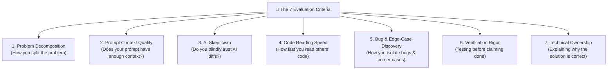
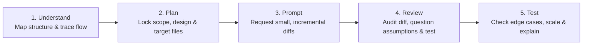

# 🧠 AI-Enabled Coding Interviews — Open-Source Hub & Playbook

[](LICENSE)
[](#master-catalog-30-github-backed-interview-cases)
[](#master-catalog-30-github-backed-interview-cases)
[](CONTRIBUTING.md)

> **A structured open-source knowledge base, interview bank, and prompt playbook for AI-Enabled Software Engineering Interviews (inspired by publicly documented AI-enabled loops at companies such as Meta, Canva, and Stripe).**  
> Built for **HR & Technical Interviewers** to evaluate real engineering judgment, and for **Software Engineers** to master the **Divide-and-Conquer (`Understand → Plan → Prompt → Review → Test`)** workflow on real open-source GitHub repositories.

---

## 📖 Table of Contents

1. [Why This Repository Exists](#1-why-this-repository-exists)
2. [What AI-Enabled Interviews Actually Evaluate (The 7 Criteria)](#2-what-ai-enabled-interviews-actually-evaluate-the-7-criteria)
3. [The Candidate Mindset: Divide & Conquer (`Understand → Plan → Prompt → Review → Test`)](#3-the-candidate-mindset-divide--conquer)
4. [Core Playbooks, Rubrics & Research Guides](#4-core-playbooks-rubrics--research-guides)
5. [Master Catalog: 30 GitHub-Backed Interview Cases](#5-master-catalog-30-github-backed-interview-cases)
   - [🟢 Easy Tier (10 Cases — `30–45 mins`)](#easy-tier-10-cases--3045-mins)
   - [🟡 Medium Tier (10 Cases — `45–60 mins`, Meta Standard Bar)](#medium-tier-10-cases--4560-mins-meta-standard-bar)
   - [🔴 Hard Tier (10 Cases — `60–75 mins`, Senior/Staff Bar)](#hard-tier-10-cases--6075-mins-seniorstaff-bar)
6. [How to Use This Hub (HR vs. Engineers)](#6-how-to-use-this-hub-hr-vs-engineers)
7. [Contributing & Community Governance](#7-contributing--community-governance)

---

## 1. Why This Repository Exists

As large technology companies (Meta, Canva, Stripe, and modern AI-native teams) increasingly replace traditional blank-screen LeetCode rounds with **AI-Enabled Coding Interviews**, the hiring signal has fundamentally shifted:

- **Old Paradigm (No AI)**: Memorize algorithms and type syntax from scratch on a blank file.
- **New Paradigm (AI-Enabled)**: Navigate an unfamiliar multi-file codebase, diagnose broken tests and seeded bugs, orchestrate AI assistants without blindly trusting their output, scale from toy fixtures to production datasets, and defend every line of code you commit.

Instead of inventing toy problems from scratch or bloating git history with vendored codebases, this hub curates **real, battle-tested open-source GitHub repositories** across **Python, TypeScript, Go, Java, Rust, and C#**, wrapping each repository with:

1. **A 4-Checkpoint Candidate Prompt** (_Explore & Trace → Fix Seeded Bugs → Implement Feature/Solver → Edge Cases & Defense_)
2. **Verified "AI Traps"** (where copy-pasting the whole prompt into GPT/Claude/Gemini produces plausible but broken code)
3. **A Reference Divide-and-Conquer Prompt Walkthrough**
4. **A Standardized 7-Criteria HR & Interviewer Grading Rubric**

---

## 2. What AI-Enabled Interviews Actually Evaluate (The 7 Criteria)

Before writing a single prompt—or grading a single candidate—understand the **7 Core Competencies** under evaluation (full rubric in **[`docs/01-THE-7-EVALUATION-CRITERIA.md`](docs/01-THE-7-EVALUATION-CRITERIA.md)**):



|   #   | Competency                       | What Strong Engineers Do (`Score 3–4`)                                               | What "Blind Vibe-Coders" Do (`Score 1–2`)                                  |
| :---: | :------------------------------- | :----------------------------------------------------------------------------------- | :------------------------------------------------------------------------- |
| **1** | **Problem Decomposition**        | Splits control via _Divide & Conquer_; isolates bugfixes from new features.          | Copy-pastes all instructions into one giant prompt.                        |
| **2** | **Prompt Context Quality**       | Supplies exact file paths, function contracts, invariants, and complexity bounds.    | Prompts _"fix the failing test"_ with zero architectural context.          |
| **3** | **Not Blindly Trusting AI**      | Audits every diff line-by-line; interrogates AI assumptions; catches AI Traps.       | Accepts 150-line AI diffs without reading; trapped in regression loops.    |
| **4** | **Code Reading Speed**           | Maps entry points, domain modules, and test harnesses within 5–10 minutes.           | Clicks randomly or relies on AI without inspecting `src/` and `tests/`.    |
| **5** | **Bug & Edge-Case Discovery**    | Diagnoses root causes; proactively tests duplicates, empty inputs, and scale limits. | Patches symptoms with hacky `if` checks; misses duplicate/boundary traps.  |
| **6** | **Testing Before Claiming Done** | Runs unit tests after every micro-change; uncomments & adds regression tests.        | Claims "done" the moment AI generates code without running the test suite. |
| **7** | **Explaining Correctness**       | Clearly defends invariants, complexity trade-offs, and regression safety.            | Says _"That's what the AI wrote and the tests turned green."_              |

---

## 3. The Candidate Mindset: Divide & Conquer

> **Key Principle:** Know _what_ you want the AI to do and _why_ **before** you prompt.  
> Pasting the entire problem and accepting the generated code may look fast for 5 minutes, but it hides your technical judgment from the interviewer and walks straight into seeded AI traps.

### The 5-Step Execution Workflow



1. **First (`Understand`)**: Ask the AI (in read-only mode) to map the repository structure and trace the execution flow (keep pre-written starter prompts ready before the interview).
2. **Second (`Plan`)**: Lock down the scope, algorithm design, and exact target files to modify _yourself_.
3. **Third (`Prompt`)**: Prompt for **one small, isolated change at a time** instead of dumping the entire requirement.
4. **Fourth (`Review`)**: After every AI edit, review the diff line-by-line, ask the AI what assumptions it made, and run the unit test suite immediately.
5. **Fifth (`Test`)**: Verify boundary edge cases, check production-scale regression risks, and explain the complete solution end-to-end.

👉 **Get the copy-pasteable prompt templates in [`docs/02-EMPLOYEE-MINDSET-AND-PROMPT-PLAYBOOK.md`](docs/02-EMPLOYEE-MINDSET-AND-PROMPT-PLAYBOOK.md).**

---

## 4. Core Playbooks, Rubrics & Research Guides

| Guide / Template                                                                                         | Audience                     | Description                                                                                                                |
| :------------------------------------------------------------------------------------------------------- | :--------------------------- | :------------------------------------------------------------------------------------------------------------------------- |
| **[`docs/01-THE-7-EVALUATION-CRITERIA.md`](docs/01-THE-7-EVALUATION-CRITERIA.md)**                       | HR, Interviewers & Engineers | Deep dive into the 7 core competencies with a `1–4` behavioral scoring rubric, green flags, and red flags.                 |
| **[`docs/02-EMPLOYEE-MINDSET-AND-PROMPT-PLAYBOOK.md`](docs/02-EMPLOYEE-MINDSET-AND-PROMPT-PLAYBOOK.md)** | Engineers & Candidates       | The **Divide and Conquer** mindset guide + ready-to-use prompt templates for `Understand → Plan → Prompt → Review → Test`. |
| **[`docs/03-HR-AND-INTERVIEWER-RUNBOOK.md`](docs/03-HR-AND-INTERVIEWER-RUNBOOK.md)**                     | HR & Hiring Managers         | 60-minute interview script, clean-room git provisioning (stripping `.git` history), and level calibration (`L3` to `L6+`). |
| **[`docs/04-HARD-LEVEL-RESEARCH-AND-AI-TRAPS.md`](docs/04-HARD-LEVEL-RESEARCH-AND-AI-TRAPS.md)**         | All                          | Research on why LeetCode Hard is obsolete with AI and the **5 Taxonomy Pillars of Hard AI-Enabled Tasks**.                 |
| **[`templates/SCORECARD_TEMPLATE.md`](templates/SCORECARD_TEMPLATE.md)**                                 | HR & Interviewers            | Copyable candidate evaluation sheet combining the 4 Checkpoints and the 7 Criteria (`1–4` scale).                          |
| **[`templates/CASE_TEMPLATE.md`](templates/CASE_TEMPLATE.md)**                                           | Contributors                 | Blueprint template for contributing new GitHub-backed interview cases.                                                     |

---

## 5. Master Catalog: 30 GitHub-Backed Interview Cases

### 🟢 Easy Tier (`10 Cases` — `30–45 mins`)

👉 **[Easy Tier Index & Routing (`cases/easy/README.md`)](cases/easy/README.md)**

|                        ID                         | Standalone Case Page                                                                                  | Source GitHub Repository                                                                                              | Languages                                  | Primary AI Trap                                                                                 |
| :-----------------------------------------------: | :---------------------------------------------------------------------------------------------------- | :-------------------------------------------------------------------------------------------------------------------- | :----------------------------------------- | :---------------------------------------------------------------------------------------------- |
|     **[E01](cases/easy/E01-gilded-rose.md)**      | [Gilded Rose Inventory Bugfix & Conjured Decay Cap](cases/easy/E01-gilded-rose.md)                    | [`emilybache/GildedRose-Refactoring-Kata`](https://github.com/emilybache/GildedRose-Refactoring-Kata)                 | `Python`, `TS`, `Go`, `Java`, `Rust`, `C#` | Post-expiration double decay & `"Conjured Sulfuras"` / `"Conjured Aged Brie"`                   |
| **[E02](cases/easy/E02-supermarket-receipt.md)**  | [Supermarket Receipt Discount Stacking & Bundle Rounding](cases/easy/E02-supermarket-receipt.md)      | [`emilybache/SupermarketReceipt-Refactoring-Kata`](https://github.com/emilybache/SupermarketReceipt-Refactoring-Kata) | `Python`, `TS`, `Go`, `Java`, `C#`         | `TWO_FOR_AMOUNT` float division bug (`quantity_as_int / x`) & partial bundle remainder drift    |
|  **[E03](cases/easy/E03-theatrical-players.md)**  | [Theatrical Players Statement Formatter & HTML Loyalty Credits](cases/easy/E03-theatrical-players.md) | [`emilybache/Theatrical-Players-Refactoring-Kata`](https://github.com/emilybache/Theatrical-Players-Refactoring-Kata) | `Python`, `TS`, `Go`, `Java`, `Rust`, `C#` | Duplicating formulas across Text/HTML & single-pass cross-play bonus bug                        |
|     **[E04](cases/easy/E04-tennis-score.md)**     | [Tennis Match Tie-Break & Advantage State Machine](cases/easy/E04-tennis-score.md)                    | [`emilybache/Tennis-Refactoring-Kata`](https://github.com/emilybache/Tennis-Refactoring-Kata)                         | `Python`, `TS`, `Go`, `Java`, `Rust`, `C#` | Hardcoded `"player1"` bug in `TennisGame1`/`TennisGame3` & `7–6` Tie-Break Advantage leak       |
|  **[E05](cases/easy/E05-lift-pass-pricing.md)**   | [Lift Pass Dynamic Pricing & Holiday Blackout Calendar](cases/easy/E05-lift-pass-pricing.md)          | [`martinsson/Refactoring-Kata-Lift-Pass-Pricing`](https://github.com/martinsson/Refactoring-Kata-Lift-Pass-Pricing)   | `Python`, `TS`, `Java`, `C#`               | Counting free `<6` children toward group discount threshold                                     |
|    **[E06](cases/easy/E06-build-pipeline.md)**    | [Build Pipeline Notification Router & Flaky Step Retry](cases/easy/E06-build-pipeline.md)             | [`emilybache/BuildPipeline-Refactoring-Kata`](https://github.com/emilybache/BuildPipeline-Refactoring-Kata)           | `Python`, `Go`, `Java`, `C#`               | Sending duplicate failure emails inside the retry loop                                          |
|     **[E07](cases/easy/E07-yatzy-scorer.md)**     | [Yatzy Category Scorer & Wild Joker Die Rule](cases/easy/E07-yatzy-scorer.md)                         | [`emilybache/Yatzy-Refactoring-Kata`](https://github.com/emilybache/Yatzy-Refactoring-Kata)                           | `Python`, `TS`, `Go`, `Java`, `Rust`, `C#` | Hand-rolled joker heuristics failing on `two_pair` & strict `fullHouse`                         |
| **[E08](cases/easy/E08-delivery-controller.md)**  | [Delivery Controller Event Replay & Next-Stop ETA](cases/easy/E08-delivery-controller.md)             | [`emilybache/DeliveryController-Refactoring-Kata`](https://github.com/emilybache/DeliveryController-Refactoring-Kata) | `Python`, `TS`, `Java`, `C#`               | Duplicate `DeliveryEvent` replay flipping late delivery to `on_time=True` & `.seconds` 24h wrap |
|    **[E09](cases/easy/E09-expense-report.md)**    | [Expense Report Meal Cap Auditor & Multi-Currency Conversion](cases/easy/E09-expense-report.md)       | [`emilybache/ExpenseReport-Refactoring-Kata`](https://github.com/emilybache/ExpenseReport-Refactoring-Kata)           | `Python`, `TS`, `Go`, `Java`, `Rust`, `C#` | Checking meal cap before currency conversion & unrounded subtotal drift                         |
| **[E10](cases/easy/E10-racing-car-telemetry.md)** | [Racing Car Telemetry Alarm & Sliding Window Drift Detector](cases/easy/E10-racing-car-telemetry.md)  | [`emilybache/Racing-Car-Katas`](https://github.com/emilybache/Racing-Car-Katas)                                       | `Python`, `TS`, `Go`, `Java`, `Rust`, `C#` | Resetting latched alarm state on next normal reading                                            |

---

### 🟡 Medium Tier (`10 Cases` — `45–60 mins`, Meta Standard Bar)

👉 **[Medium Tier Index & Routing (`cases/medium/README.md`)](cases/medium/README.md)**

|                            ID                             | Standalone Case Page                                                                                         | Source GitHub Repository                                                                                                                                                                                                                                                                        | Languages                            | Primary AI Traps                                                                                        |
| :-------------------------------------------------------: | :----------------------------------------------------------------------------------------------------------- | :---------------------------------------------------------------------------------------------------------------------------------------------------------------------------------------------------------------------------------------------------------------------------------------------- | :----------------------------------- | :------------------------------------------------------------------------------------------------------ |
|    **[M01](cases/medium/M01-wordle-puzzle-solver.md)**    | **[Secret Word Puzzle & Entropy Solver Engine](cases/medium/M01-wordle-puzzle-solver.md)** _(Meta Flagship)_ | [`natashalukmanto/dsa`](https://github.com/natashalukmanto/dsa) · [`jason-chao/wordle-solver`](https://github.com/jason-chao/wordle-solver) · [`jonhoo/roget`](https://github.com/jonhoo/roget)                                                                                                 | `Python`, `TS`, `Go`, `Java`, `Rust` | Duplicate-letter `Match.MOVE` bug + variable length `1..6` + $O(N^2)$ timeout on prod dictionary        |
| **[M02](cases/medium/M02-legacy-service-refactoring.md)** | [Legacy Service Refactoring & Dependency Inversion](cases/medium/M02-legacy-service-refactoring.md)          | [`JLLeitschuh/refactoring-interview-question`](https://github.com/JLLeitschuh/refactoring-interview-question)                                                                                                                                                                                   | `Java`, `Kotlin`                     | Mutable `Dijkstra.source` field leak + N+1 `GraphService` lookup + non-atomic `failFast=true` batch     |
|   **[M03](cases/medium/M03-concurrent-worker-pool.md)**   | [Concurrent Worker Pool & Graceful Context Cancellation](cases/medium/M03-concurrent-worker-pool.md)         | [`sourcegraph/conc`](https://github.com/sourcegraph/conc) · [`RezaSi/go-interview-practice`](https://github.com/RezaSi/go-interview-practice)                                                                                                                                                   | `Go`, `TS`, `Python`, `Rust`         | `cancel()`-before-`addErr(err)` race + goroutine leak on early error + `send on closed channel` panic   |
|   **[M04](cases/medium/M04-http-retry-middleware.md)**    | [HTTP Retry Middleware & Exponential Backoff Jitter](cases/medium/M04-http-retry-middleware.md)              | [`sindresorhus/ky`](https://github.com/sindresorhus/ky) / [`encode/httpx`](https://github.com/encode/httpx)                                                                                                                                                                                     | `TS`, `Python`, `Go`                 | `parseInt` on HTTP-date `Retry-After` header + re-sending consumed stream body                          |
|     **[M05](cases/medium/M05-radix-trie-router.md)**      | [Radix Trie URL Router & Wildcard Param Precedence](cases/medium/M05-radix-trie-router.md)                   | [`honojs/hono`](https://github.com/honojs/hono) / [`go-chi/chi`](https://github.com/go-chi/chi)                                                                                                                                                                                                 | `TS`, `Go`, `Python`, `Rust`         | Greedy static branch failing to backtrack + polluted `params` object                                    |
|  **[M06](cases/medium/M06-conduit-feed-pagination.md)**   | [Conduit Article Feed Pagination & N+1 Tag Hydration](cases/medium/M06-conduit-feed-pagination.md)           | [`nsidnev/fastapi-realworld-example-app`](https://github.com/nsidnev/fastapi-realworld-example-app) · [`node-express-realworld`](https://github.com/gothinkster/node-express-realworld-example-app) · [`golang-gin-realworld`](https://github.com/gothinkster/golang-gin-realworld-example-app) | `Python`, `TS`, `Go`, `Java`         | `articles_count=len(articles)` bug + `1+5N` query loop + `LIMIT` applied to `JOIN`ed tag rows           |
|  **[M07](cases/medium/M07-markdown-table-tokenizer.md)**  | [Markdown Table & Footnote AST Tokenizer](cases/medium/M07-markdown-table-tokenizer.md)                      | [`executablebooks/markdown-it-py`](https://github.com/executablebooks/markdown-it-py)                                                                                                                                                                                                           | `Python`, `TS`, `Rust`               | `escapedSplit` backslash parity bug + splitting pipe `\|` inside inline backticks `` `a \| b` ``        |
|   **[M08](cases/medium/M08-ttl-lru-cache-stampede.md)**   | [In-Memory TTL Cache with LRU Eviction & Stampede Lock](cases/medium/M08-ttl-lru-cache-stampede.md)          | [`hashicorp/golang-lru`](https://github.com/hashicorp/golang-lru) / [`isaacs/node-lru-cache`](https://github.com/isaacs/node-lru-cache)                                                                                                                                                         | `Go`, `TS`, `Python`, `Java`         | Evicting live LRU item while expired items occupy capacity + holding global lock during slow `loaderFn` |
|   **[M09](cases/medium/M09-cli-option-precedence.md)**    | [CLI Subcommand Option Parser & Env-Var Fallback Precedence](cases/medium/M09-cli-option-precedence.md)      | [`pallets/click`](https://github.com/pallets/click) / [`tj/commander.js`](https://github.com/tj/commander.js)                                                                                                                                                                                   | `Python`, `TS`, `Go`, `Rust`         | Falsy CLI values (`False`, `0`, `""`) falling through `cli or env or default`                           |
|    **[M10](cases/medium/M10-event-sourced-ledger.md)**    | [Event-Sourced Bank Ledger & Out-of-Order Webhook Reconciliation](cases/medium/M10-event-sourced-ledger.md)  | [`MARKASCHARAN/ChronoLedger`](https://github.com/MARKASCHARAN/ChronoLedger) · [`Zubimendi/ReplayLedger`](https://github.com/Zubimendi/ReplayLedger) · [`HARRIFIED/Event-sourced-core-banking`](https://github.com/HARRIFIED/Event-sourced-core-banking)                                         | `TS`, `Go`, `Python`, `Java`         | Out-of-order `CAPTURE` before `HOLD` + partial capture not releasing remainder                          |

---

### 🔴 Hard Tier (`10 Cases` — `60–75 mins`, Senior/Staff Bar)

👉 **[Hard Tier Index & Routing (`cases/hard/README.md`)](cases/hard/README.md)**

|                             ID                             | Standalone Case Page                                                                                              | Source GitHub Repository                                                                                                                                                                                              | Languages                                  | Compounding AI Traps                                                                                    |
| :--------------------------------------------------------: | :---------------------------------------------------------------------------------------------------------------- | :-------------------------------------------------------------------------------------------------------------------------------------------------------------------------------------------------------------------- | :----------------------------------------- | :------------------------------------------------------------------------------------------------------ |
|      **[H01](cases/hard/H01-httpx-redirect-pool.md)**      | [Async HTTP Connection Pool & Cross-Origin Redirect Auth Leak](cases/hard/H01-httpx-redirect-pool.md)             | [`encode/httpx`](https://github.com/encode/httpx)                                                                                                                                                                     | `Python`                                   | `CancelledError` (`BaseException`) pool leak + mutating `history` headers + OAuth cookie redirect cycle |
|       **[H02](cases/hard/H02-zod-cyclic-schema.md)**       | [Recursive Schema Validation & Cyclic Object Graph Tracker](cases/hard/H02-zod-cyclic-schema.md)                  | [`colinhacks/zod`](https://github.com/colinhacks/zod)                                                                                                                                                                 | `TypeScript`                               | Global `WeakSet` breaking shared DAG siblings vs. ancestor cycles + async path race                     |
|     **[H03](cases/hard/H03-bubbletea-event-loop.md)**      | [Concurrent TUI Event Loop & Command Batching Deadlock](cases/hard/H03-bubbletea-event-loop.md)                   | [`charmbracelet/bubbletea`](https://github.com/charmbracelet/bubbletea)                                                                                                                                               | `Go`                                       | `close(p.msgs)` panic while `Cmd` goroutines send + unbuffered shutdown deadlock                        |
|   **[H04](cases/hard/H04-gson-polymorphic-adapter.md)**    | [Polymorphic JSON `TypeAdapter` & Number Precision Trap](cases/hard/H04-gson-polymorphic-adapter.md)              | [`google/gson`](https://github.com/google/gson)                                                                                                                                                                       | `Java`                                     | 64-bit `Long` truncated to `double` via `JsonTreeReader` + `FutureTypeAdapter` thread-cache race        |
|     **[H05](cases/hard/H05-serde-streaming-json.md)**      | [Zero-Copy Streaming JSON Deserializer & Buffer Boundary](cases/hard/H05-serde-streaming-json.md)                 | [`serde-rs/json`](https://github.com/serde-rs/json)                                                                                                                                                                   | `Rust`                                     | Multi-byte UTF-8 emoji split across `Read::read` chunks + `'de` vs `'s` scratch lifetime                |
|    **[H06](cases/hard/H06-pydantic-validator-mro.md)**     | [Model Validator Inheritance MRO & Default Factory Mutation Leak](cases/hard/H06-pydantic-validator-mro.md)       | [`pydantic/pydantic`](https://github.com/pydantic/pydantic)                                                                                                                                                           | `Python`                                   | Reversing MRO fixes `mode='after'` but breaks `mode='before'` + blanket `deepcopy` crash                |
|   **[H07](cases/hard/H07-tanstack-optimistic-query.md)**   | [Async Query Cache Deduplication & Optimistic Rollback Race](cases/hard/H07-tanstack-optimistic-query.md)         | [`TanStack/query`](https://github.com/TanStack/query)                                                                                                                                                                 | `TypeScript`                               | Overlapping optimistic mutations rolling back to stale snapshot + shared `AbortSignal`                  |
|    **[H08](cases/hard/H08-cobra-flag-propagation.md)**     | [Hierarchical CLI Flag Propagation & PersistentPreRun Hook Shadowing](cases/hard/H08-cobra-flag-propagation.md)   | [`spf13/cobra`](https://github.com/spf13/cobra)                                                                                                                                                                       | `Go`                                       | Breaking default Cobra hook shadowing + running `PostRun` for failed `PreRun` ancestors                 |
|     **[H09](cases/hard/H09-rich-wide-char-table.md)**      | [ANSI Wide-Character Table Layout Engine & Wrapping Perf Cliff](cases/hard/H09-rich-wide-char-table.md)           | [`Textualize/rich`](https://github.com/Textualize/rich)                                                                                                                                                               | `Python`                                   | `max_width=1` infinite loop on 2-cell CJK + `bisect` on `span.start` dropping outer spans               |
| **[H10](cases/hard/H10-legacy-billing-ai-slop-rescue.md)** | [Multi-Language Legacy Billing & Rule Engine ("AI-Slop" Rescue)](cases/hard/H10-legacy-billing-ai-slop-rescue.md) | [`stripe-samples/subscription-use-cases`](https://github.com/stripe-samples/subscription-use-cases) · [`getlago/lago`](https://github.com/getlago/lago) · [`killbill/killbill`](https://github.com/killbill/killbill) | `Python`, `TS`, `Go`, `Java`, `Rust`, `C#` | Tautological mock tests + Hamilton penny-splitting remainder + mutated shared rate cache                |

---

## 6. How to Use This Hub (HR vs. Engineers)

### For HR, Talent Acquisition & Engineering Interviewers

1. **Pick a Case**: Select a case matching the candidate's target level (`Easy` for L3, `Medium` for L4/L5, `Hard` for L5/L6+) and preferred language.
2. **Prepare the Clean-Room Workspace** (`2 mins`):
   ```bash
   git clone <SOURCE_GITHUB_REPO_URL> interview-session
   cd interview-session
   rm -rf .git && git init && git add . && git commit -m "Initial interview baseline"
   ```
   _(Stripping `.git` ensures neither the candidate nor their AI agent can run `git log` or `git blame` to view past commits.)_
3. **Share Only Section 2 (_Candidate Instructions_)**: Paste the 4 Checkpoints into CoderPad / Codespaces / `INSTRUCTIONS.md`.
4. **Grade with the 7-Criteria Scorecard**: Use [`templates/SCORECARD_TEMPLATE.md`](templates/SCORECARD_TEMPLATE.md) alongside the case's **AI Trap Analysis** and **HR Grading Key**.

### For Software Engineers & Employees (Self-Practice & Mock Interviews)

1. Study [`docs/02-EMPLOYEE-MINDSET-AND-PROMPT-PLAYBOOK.md`](docs/02-EMPLOYEE-MINDSET-AND-PROMPT-PLAYBOOK.md) and copy the pre-written prompts for **Phase 1 (`Understand`)** through **Phase 5 (`Test`)**.
2. Clone a case's target GitHub repo and read **only the Candidate Instructions (Checkpoints 1–4)**.
3. Set a 60-minute timer and practice executing `Understand → Plan → Prompt → Review → Test` while narrating your reasoning out loud.
4. Afterward, compare your prompts and edge-case tests against Section 3 (_The AI Trap_) and Section 5 (_HR Grading Key_).

---

## 7. Contributing & Community Governance

We welcome contributions from engineering leaders, HR teams, and developers worldwide!

- **Propose a New Case**: Use [`templates/CASE_TEMPLATE.md`](templates/CASE_TEMPLATE.md) or open a [New Interview Case Issue](.github/ISSUE_TEMPLATE/new_interview_case.yml).
- **Share an AI Trap**: Found a subtle way GPT/Claude/Gemini fails on an open-source codebase? Submit an [AI Trap / Rubric Update](.github/ISSUE_TEMPLATE/ai_trap_or_rubric_update.yml).
- **Read Our Guidelines**:
  - [Contributing Guide (`CONTRIBUTING.md`)](CONTRIBUTING.md)
  - [Governance & Quality Bar (`GOVERNANCE.md`)](GOVERNANCE.md)
  - [Code of Conduct (`CODE_OF_CONDUCT.md`)](CODE_OF_CONDUCT.md)
  - [Security & Confidentiality Policy (`SECURITY.md`)](SECURITY.md)
  - [Support Guide (`SUPPORT.md`)](SUPPORT.md)
