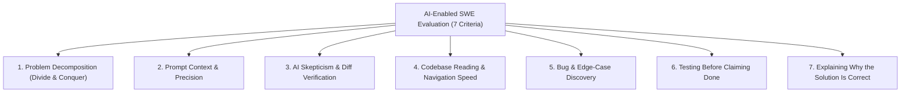

# The 7 Evaluation Criteria of AI-Enabled Coding Interviews

In traditional algorithmic interviews (LeetCode-style), interviewers evaluated syntax recall and memorized data-structure patterns on a blank file. In modern **AI-Enabled SWE Interviews** (used by companies such as Meta, Canva, and Stripe), candidates have full access to frontier LLMs (Claude, GPT, Gemini) inside a multi-file codebase.

When AI can generate syntax in seconds, **speed of typing is no longer the signal—technical judgment and control over the AI are.**

Every interview case in this repository is engineered to evaluate **7 Core Engineering Competencies**.

---

## Overview: The 7 Competencies at a Glance

---

## Detailed Breakdown & 1–4 Behavioral Rubric

### 1. Problem Decomposition (_How You Split the Problem_)

> **Core Question:** Does the engineer break a complex multi-stage requirement into small, controllable sub-problems (_Divide and Conquer_), or do they dump the entire requirement into the AI at once?

| Score                      | Behavioral Anchor                                                                                                                                                                      |
| :------------------------- | :------------------------------------------------------------------------------------------------------------------------------------------------------------------------------------- |
| **1 (Blind Vibe-Coder)**   | Copy-pastes the entire problem description into the AI prompt and asks for a complete end-to-end solution in one shot.                                                                 |
| **2 (Weak Decomposition)** | Breaks the problem only when the AI's giant output fails to compile or pass tests; lacks an upfront plan.                                                                              |
| **3 (Solid Orchestrator)** | Explicitly separates exploration, bug fixing, core logic, and optimization into sequential steps; locks down scope before prompting.                                                   |
| **4 (Force-Multiplier)**   | Decomposes the task along clean architectural seams (interfaces, data contracts, state transitions), keeping himself/herself as the architect and using AI only for scoped leaf tasks. |

---

### 2. Prompt Context & Precision (_Does Your Prompt Have Enough Context?_)

> **Core Question:** Does the engineer know _what_ they want the AI to do and _why_ before prompting, supplying exact file paths, constraints, and invariants?

| Score                         | Behavioral Anchor                                                                                                                                                                     |
| :---------------------------- | :------------------------------------------------------------------------------------------------------------------------------------------------------------------------------------ |
| **1 (Vague / Context-Free)**  | Prompts like _"Fix the bug in solver"_ or _"Make the tests pass"_ without specifying target functions, data types, or invariants.                                                     |
| **2 (Under-Specified)**       | Provides partial context; omits critical constraints (e.g., performance bounds, immutability, or existing helper functions), causing the AI to reinvent or break existing modules.    |
| **3 (Context-Rich & Scoped)** | Specifies exact file names, function signatures, input/output contracts, and what _not_ to touch (`"Update only Puzzle.guess() in puzzle.py; preserve the Match enum contract"`).     |
| **4 (Surgical Prompting)**    | Uses structured two-phase prompting: first prompts AI to map/verify context, then issues tightly constrained micro-prompts with explicit edge-case invariants and complexity targets. |

---

### 3. Not Blindly Trusting AI (_AI Skepticism & Diff Verification_)

> **Core Question:** Does the engineer treat AI output like an untrusted Pull Request from a fast but error-prone junior developer—reviewing every line of the diff and interrogating hidden assumptions?

| Score                        | Behavioral Anchor                                                                                                                                                      |
| :--------------------------- | :--------------------------------------------------------------------------------------------------------------------------------------------------------------------- |
| **1 (Blind Trust)**          | Clicks "Accept/Apply" or copies AI code straight into the editor without reading it; falls directly into every seeded AI Trap.                                         |
| **2 (Surface Skimmer)**      | Glances at AI code to see if it looks syntactically valid, but misses subtle logic bugs, off-by-one errors, or mutated shared state until tests blow up.               |
| **3 (Critical Auditor)**     | Reads every line of the AI diff before running it; asks the AI _"What assumptions did you make about X?"_ and rejects over-engineered or buggy snippets.               |
| **4 (Adversarial Reviewer)** | Immediately spots where the LLM hallucinated an invariant or used a naive algorithm; overrides or rewrites vulnerable sections before they ever touch the test runner. |

---

### 4. Code Reading Speed (_How Fast You Read Others' Code_)

> **Core Question:** How quickly can the engineer orient themselves in a 5-to-15 file repository written by someone else, tracing entry points, module dependencies, and test harnesses?

| Score                     | Behavioral Anchor                                                                                                                                                                |
| :------------------------ | :------------------------------------------------------------------------------------------------------------------------------------------------------------------------------- |
| **1 (Lost in the Repo)**  | Spends 15+ minutes randomly clicking files or relies entirely on AI without opening the source files to verify how the project is wired.                                         |
| **2 (Slow / Fragmented)** | Reads files line-by-line from top to bottom without tracing the call graph; misses where `data/` fixtures or test helpers connect to `src/`.                                     |
| **3 (Fast Navigator)**    | Uses AI strategically to map the architecture first, then jumps directly to entry points, core domain classes, and unit tests within 5–10 minutes.                               |
| **4 (X-Ray Code Reader)** | Rapidly traces execution flow across modules, identifies hidden side effects, and spots architectural smells or mismatches between docstrings and implementation within minutes. |

---

### 5. Bug & Edge-Case Discovery (_How You Find Bugs and Edge Cases_)

> **Core Question:** Can the engineer diagnose root causes in broken legacy code and proactively uncover boundary conditions (duplicates, empty inputs, concurrency races, scale bottlenecks)?

| Score                       | Behavioral Anchor                                                                                                                                                                                     |
| :-------------------------- | :---------------------------------------------------------------------------------------------------------------------------------------------------------------------------------------------------- |
| **1 (Symptom Patcher)**     | Cannot find the bug without pasting error logs into AI; applies band-aid `if` checks that hardcode around failing test inputs.                                                                        |
| **2 (Happy-Path Only)**     | Fixes the obvious bug flagged by an existing failing test, but misses secondary bugs or edge cases (e.g., duplicate letters in Wordle, `null`/empty payloads, integer overflow).                      |
| **3 (Root-Cause Debugger)** | Traces state step-by-step, isolates the exact root cause of seeded bugs, and systematically enumerates boundary conditions before moving on.                                                          |
| **4 (Edge-Case Hunter)**    | Proactively identifies non-obvious failure modes (toy vs. production dataset divergence, cache poisoning, race conditions, partial failure rollback) and prompts AI specifically to stress-test them. |

---

### 6. Testing Before Claiming Done (_Verification Rigor_)

> **Core Question:** Does the engineer run existing tests after every small change and write new unit tests for fixed bugs and edge cases _before_ declaring a checkpoint complete?

| Score                        | Behavioral Anchor                                                                                                                                                                   |
| :--------------------------- | :---------------------------------------------------------------------------------------------------------------------------------------------------------------------------------- |
| **1 (Unverified "Done")**    | Claims the task is finished as soon as the code is pasted, without running the test suite or checking program output.                                                               |
| **2 (Manual / Late Tester)** | Only runs tests at the very end of the interview, or relies only on the default `main` run button without running the unit test suite (`test_*.py`) or uncommenting disabled tests. |
| **3 (Test-Driven Verifier)** | Runs the test suite at baseline, after every micro-change, and uncomments/adds unit tests for newly implemented logic before moving to the next checkpoint.                         |
| **4 (Regression Guardian)**  | Writes targeted regression tests _before_ or alongside fixes, tests against both toy and production datasets, and verifies performance/memory bounds.                               |

---

### 7. Explaining Why the Solution Is Correct (_Technical Ownership & Defense_)

> **Core Question:** Can the engineer clearly explain the end-to-end solution, defend complexity and architectural trade-offs, and prove why no regressions were introduced?

| Score                            | Behavioral Anchor                                                                                                                                                                  |
| :------------------------------- | :--------------------------------------------------------------------------------------------------------------------------------------------------------------------------------- |
| **1 (No Ownership)**             | Cannot explain how the AI-generated algorithm works; says _"That's what the AI suggested and the tests passed."_                                                                   |
| **2 (Superficial Explanation)**  | Gives a high-level summary of what the code does line-by-line, but struggles when asked _"What happens if input X scales by 100x?"_ or _"Why did you choose this data structure?"_ |
| **3 (Clear Owner)**              | Articulates the problem, root cause of bugs, why the chosen algorithm is correct, its time/space complexity, and how edge cases are handled.                                       |
| **4 (Staff-Level Communicator)** | Narrates decisions concisely throughout the session; concludes with a crisp architectural walkthrough covering invariants, regression risks, trade-offs, and production-readiness. |

---

## Summary: Why "Fast Copy-Paste" Fails This Rubric

If a candidate simply copies the problem statement into an AI assistant and accepts the generated code:

- They may finish **Checkpoint 1 or 2 quickly** on an Easy problem.
- However, they score **1/4 on Criteria #1, #2, #3, and #7**, and the moment they hit a **Medium or Hard AI Trap**, they get stuck in a "prompt thrashing" loop where the AI repeatedly breaks one test while fixing another.
- The **Divide-and-Conquer workflow (`Understand → Plan → Prompt → Review → Test`)** documented in [02-EMPLOYEE-MINDSET-AND-PROMPT-PLAYBOOK.md](02-EMPLOYEE-MINDSET-AND-PROMPT-PLAYBOOK.md) is designed specifically to maximize all 7 criteria.
