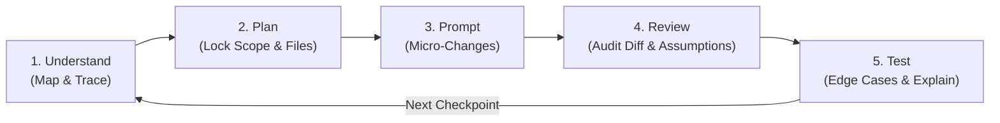

# Employee Mindset & Prompt Playbook: Divide and Conquer

> **The Golden Rule of AI-Enabled Interviews:**  
> You must know **what** you want the AI to do and **why** _before_ you write a prompt.  
> If you paste the problem statement and blindly accept the generated code, you might move fast for 5 minutes—but the interviewer will see **zero technical judgment**, and you will walk straight into seeded **AI Traps**.

This playbook gives you the mental model, the 5-step execution workflow, and **pre-written prompt templates** you can memorize and adapt in any AI-enabled coding interview or real-world engineering task.

---

## 1. Core Mindset: Divide and Conquer (Splitting Control)

In an AI-enabled interview, think of yourself as the **Tech Lead / Staff Architect** and the AI assistant as a **fast but reckless junior developer** who has never seen your production invariants.

| Responsibility                                  |       Who Owns It?       | Why?                                                                          |
| :---------------------------------------------- | :----------------------: | :---------------------------------------------------------------------------- |
| **Mapping architecture & reading tests**        | **You + AI (Read-Only)** | AI summarizes fast, but you must verify the entry points and test contracts.  |
| **Defining scope, design & target files**       |       **100% You**       | Never let the AI decide which modules or public interfaces to rewrite.        |
| **Writing localized boilerplate / small diffs** |  **AI (Guided by You)**  | Prompt one small, verifiable change at a time instead of the whole feature.   |
| **Reviewing diffs & questioning assumptions**   |       **100% You**       | Catch off-by-one bugs, mutated state, and $O(N^2)$ traps before running code. |
| **Testing edge cases & explaining correctness** |       **100% You**       | You own every line committed and must defend why the solution is sound.       |

---

## 2. The 5-Step Execution Loop

Every checkpoint in an interview should follow this exact loop:



---

## 3. Pre-Written Prompt Library (Memorize & Adapt Before Your Interview)

Below are battle-tested prompt templates for each stage of the **Divide and Conquer** workflow.

### Phase 1: `Understand` — Map Structure & Trace Execution Flow

_Goal: Orient yourself in an unfamiliar multi-file codebase in under 5 minutes without letting the AI write any code yet._

#### Prompt 1A: Architecture & Call-Graph Mapper

```text
Do NOT write or modify any code yet.
Read the files in this workspace and give me a concise architectural map:
1. Entry point(s) and how the program/tests are executed.
2. Core domain classes/functions in `src/` and their responsibilities.
3. How data flows from input/fixtures (`data/`) through the core logic to output.
4. Any commented-out tests, TODOs, or suspicious edge-case handling in `test_*`.
Keep your answer brief and bulleted with file:line references.
```

#### Prompt 1B: Execution Flow & Invariant Tracer

```text
Do NOT suggest code changes yet.
Trace the exact step-by-step execution flow when `<ClassName.method_name(sample_input)>` is called:
1. What state variables are read or mutated?
2. What assumptions does the current implementation make about the input (e.g., duplicates, ordering, null/empty values, size)?
3. Where could this logic violate the specification in `<INSTRUCTIONS / docstring>`?
```

---

### Phase 2: `Plan` — Lock Scope, Design & Target Files Yourself

_Goal: Before prompting for code, state your plan out loud to the interviewer and verify your design._

**Checklist to state out loud to your interviewer:**

1. _"Based on the test suite and `src/`, here are the exact 1–2 files we need to touch: `[file_a]` and `[file_b]`."_
2. _"The existing bug in `[file_a]` happens because `[root cause]`. I will fix that first and verify with a unit test before building `[new feature]`."_
3. _"For `[new feature]`, a naive approach would be $O(N^2)$ / break on duplicate items, so I am going to use `[algorithm/data structure]` and ask the AI to implement only the helper function first."_

#### Prompt 2A: Design Sanity-Check (Optional, For Hard Problems)

```text
I plan to solve `<specific sub-problem>` in `<target_file>` using this approach:
- Data structure / state: <your choice>
- Step 1: <step 1>
- Step 2: <step 2>
- Complexity target: <e.g., O(N) time, O(K) space>

Do NOT write the implementation yet. Critique my plan in 3 bullet points:
1. Does this break any existing method contracts or callers in the repo?
2. What edge cases (duplicates, empty input, scale, concurrency) could break this design?
```

---

### Phase 3: `Prompt` — Incremental Micro-Changes (Never Dump the Whole Spec)

_Goal: Retain 100% control by asking for one small, isolated change at a time._

#### Prompt 3A: Scoped Bugfix Prompt

```text
In `<file_path>`, `<function_name>` currently fails when `<describe failing case / root cause>`.
Modify ONLY `<function_name>` to fix this issue:
- Constraint 1: Preserve the existing function signature and return type `<type>`.
- Constraint 2: Properly handle `<specific edge case, e.g., duplicate letters / two-pass matching>`.
- Constraint 3: Do not modify any other functions or files.
Show me the minimal diff and explain in 2 sentences why this fix handles `<edge case>`.
```

#### Prompt 3B: Scoped Feature / Solver Step Prompt

```text
We are implementing `<Feature/Solver>` in `<file_path>` incrementally.
For this step, implement ONLY `<helper_or_method_name>`:
- Input: `<exact types and invariants>`
- Output: `<exact return type>`
- Algorithm to use: `<specify your chosen algorithm, e.g., candidate filtering by feedback mask + frequency scoring>`
- Performance constraint: Must run in under `<X ms>` on `get_prod_dictionary()` (`<N>` items).
Do not add external dependencies. Provide clean, well-typed code for this method only.
```

---

### Phase 4: `Review` — Audit Diff, Interrogate Assumptions & Run Tests

_Goal: Catch AI hallucinations and subtle traps before committing to the change._

**What to do every time the AI outputs code:**

1. **Read the diff line-by-line** before copying or applying it.
2. **Ask the Assumption Interrogation Prompt** if anything looks non-obvious.
3. **Run the unit test suite immediately** (`pytest`, `npm test`, `go test ./...`, etc.).

#### Prompt 4A: Assumption & Trap Interrogation Prompt

```text
Before I apply your code for `<function_name>`, answer concisely:
1. What implicit assumptions does your implementation make about input size, mutability, duplicates, or ordering?
2. Is there any input that would cause your code to raise an unhandled exception, enter an infinite loop, or exceed `<time/memory limit>`?
3. Did you mutate any input arguments or shared state in-place?
```

---

### Phase 5: `Test` — Edge Cases, Regression Risk & Final Solution Explanation

_Goal: Prove your solution works under adversarial inputs and deliver a Staff-level summary to the interviewer._

#### Prompt 5A: Adversarial Edge-Case Test Generator

```text
Look at our changes in `<file_path>` and the existing test suite in `<test_file_path>`.
Propose 5 high-signal unit test cases covering tricky boundary conditions:
1. Empty / minimal input
2. Duplicate / repeated elements
3. Boundary / tie-breaking conditions
4. Invalid / malformed state transitions
5. Production-scale performance / stress test (`get_prod_dictionary()` / large dataset)
Write the test functions following the exact style of `<test_file_path>`.
```

#### Final 60-Second Walkthrough Script (For the Interviewer)

At the end of the interview (Minutes 55–60), summarize your work without waiting to be asked:

1. **Root Cause Fixed**: _"In Checkpoint 2, the existing bug was caused by `[X]`, which failed on `[edge case]`. We fixed it by `[Y]` and added regression tests."_
2. **Core Architecture**: _"In Checkpoint 3, we structured `[Solver/Feature]` using `[design]`, achieving `O(...)` time and `O(...)` space so it scales cleanly from the toy fixture to the production dataset."_
3. **AI Guardrails Applied**: _"During implementation, the AI initially suggested `[naive approach / bug]`, which I rejected/modified because `[reason]`."_
4. **Production Readiness & Next Steps**: _"If we were shipping this to production, the next thing I would add is `[observability / streaming / concurrency lock / property-based tests]`."_

---

## 4. Common Anti-Patterns to Avoid at All Costs

| Anti-Pattern                | What the Interviewer Sees                                                                                                   | What to Do Instead                                                                                                                                     |
| :-------------------------- | :-------------------------------------------------------------------------------------------------------------------------- | :----------------------------------------------------------------------------------------------------------------------------------------------------- |
| **The Silent Copy-Paster**  | You paste the prompt, stay silent for 3 minutes, paste 150 lines of AI code, and hit Run.                                   | Narrate your plan out loud _before_ prompting: _"I'm asking AI to draft just the filter helper while I check the test cases."_                         |
| **Prompt Thrashing**        | A test fails; you paste the stack trace into AI with _"Still broken, fix it"_ 4 times in a row.                             | Stop prompting! Read the failing test assertion, print/trace the actual vs. expected value yourself, find the root cause, then issue a precise prompt. |
| **Scope Creep Refactoring** | AI rewrites 5 unrelated functions, changes formatting, or alters public API signatures.                                     | Reject the diff immediately. Tell AI: _"Revert unrelated changes; only modify lines X–Y inside `target_func`."_                                        |
| **Toy-Dataset Complacency** | Passing `get_test_dictionary()` (30 words) and assuming you're done without testing `get_prod_dictionary()` (50,000 words). | Always test against both the small test fixture and the production dataset before claiming done.                                                       |
