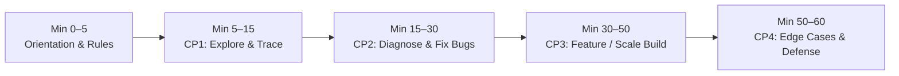

# HR & Interviewer Runbook: Conducting AI-Enabled Coding Interviews

This runbook equips **HR / Talent Acquisition Specialists**, **Engineering Managers**, and **Technical Interviewers** to run consistent, high-signal 60-minute AI-Enabled SWE Coding Interviews using the open-source GitHub cases in this repository.

---

## 1. How Industry Leaders Run AI-Enabled Interviews

| Company Benchmark | Environment & Tooling | Primary Signal Evaluated |
| :--- | :--- | :--- |
| **Meta** (*AI-Enabled SWE Round*) | 60-minute CoderPad session with multi-file workspace (`src/`, `data/`, `test_*`) + built-in AI assistant (Claude / GPT / Gemini / Llama). | Navigating an existing codebase, uncommenting/fixing tests, resolving seeded bugs, implementing a solver/feature, and auditing AI diffs. |
| **Canva** (*AI-Assisted Practical Loop*) | Local IDE (Cursor, VS Code + Copilot, Claude) or sandboxed repo on a realistic product/backend module. | Strategic prompting, requirement scoping, PR-ready code quality, and defending architectural trade-offs. |
| **Stripe** (*Bug Bash & Integration Loop*) | Existing multi-file repository with complex business rules, parsing, or state machines + AI chat. | Reading specs carefully, catching subtle corner cases that AI misses, and writing regression tests before claiming done. |

---

## 2. Pre-Interview Workspace Setup (5 Minutes Before Session)

Because our cases use **real open-source GitHub repositories**, you must prepare a **clean-room baseline** so the candidate (or their AI agent!) cannot run `git log`, `git blame`, or `git show` to look up the historical fix.

### Step-by-Step Clean-Room Provisioning
```bash
# 1. Clone the target GitHub repository from the Case Blueprint
git clone <REPO_URL> candidate-session
cd candidate-session

# 2. Checkout the exact commit or tag specified in the Case Blueprint
git checkout <COMMIT_SHA_OR_TAG>

# 3. Apply the seeded bug / commented-test setup noted in the Case Blueprint (if applicable)

# 4. CRITICAL: Strip git history so `git log` / `git diff` cannot leak solutions!
rm -rf .git
git init
git add .
git commit -m "Initial interview workspace baseline"
```

> **Pro Tip for CoderPad / HackerRank / Codespaces:**  
> Upload the stripped directory once as a **Reusable Custom Pad / Template** for each language (`Python`, `TypeScript`, `Go`, `Java`, `Rust`) and paste Section 2 (*Candidate Instructions*) of the Case Blueprint into the `INSTRUCTIONS.md` panel.

---

## 3. The 60-Minute Interview Timeline & Script



### Minutes 0–5: Welcome & Ground Rules
Read or paraphrase this script to set clear expectations:
> *"Welcome! Today's 60-minute session simulates how we engineer software in the real world. You have a multi-file codebase, a unit test suite, and full access to the AI Assistant. You can use the AI as much or as little as you'd like. However, I am evaluating **your engineering judgment**—how you explore the code, break down the problem, verify what the AI generates, test edge cases, and explain why your solution works. Please think out loud so I can follow your reasoning."*

### Minutes 5–15: Checkpoint 1 — Explore & Trace
- **What the Candidate Should Do**: Open the files, run the main entrypoint, switch to the test runner, uncomment any commented-out unit tests, and map the flow.
- **What the Interviewer Watches For**:
  - *Green Flag*: Candidate reads `src/` and `test_*` (or asks AI for a read-only architectural summary) *before* asking AI to edit code.
  - *Red Flag*: Candidate immediately copies `INSTRUCTIONS.md` into the AI chat without opening a single source file.

### Minutes 15–30: Checkpoint 2 — Diagnose & Fix Seeded Bugs
- **What the Candidate Should Do**: Identify why the unit tests fail and fix the underlying bug(s) in the existing module.
- **Interviewer Probing Question**:
  - *"Before you apply that AI fix, can you walk me through why the original code failed on that input?"*

### Minutes 30–50: Checkpoint 3 — Implement Core Feature / Scale Target
- **What the Candidate Should Do**: Implement the core solver, feature extension, or production-scale optimization.
- **What the Interviewer Watches For**:
  - Does the candidate use **Divide and Conquer** (prompting one helper/step at a time), or do they dump the entire requirement and accept a 150-line hallucinated diff?
  - How do they react when they hit the case's **AI Trap**?

### Minutes 50–60: Checkpoint 4 — Edge Cases, Regression Check & Defense
- **What the Candidate Should Do**: Run the full test suite against both toy and production fixtures, add boundary tests, and explain the solution.
- **Mandatory Interviewer Stress-Test Questions** (Pick 2):
  1. *"What assumptions did the AI make in `<function_name>` that you had to verify or change?"*
  2. *"What happens to your time and memory complexity if the dataset grows by 100x?"*
  3. *"If a teammate submitted this diff in a Pull Request, what edge case would you ask them to add a test for?"*

---

## 4. Calibrating Levels: Junior vs. Mid vs. Senior / Staff

You can use the **same case** across multiple engineering levels or select from `Easy`, `Medium`, and `Hard` tiers:

| Target Level | Recommended Case Tier | Passing Bar (Checkpoints + 7 Criteria Average) |
| :--- | :--- | :--- |
| **Junior (L3)** | **Easy** (or Medium with hints) | Completes Checkpoints 1–3; Average Score `>= 2.7`; demonstrates basic test verification and can explain every line of AI code they keep. |
| **Mid-Level (L4)** | **Medium** | Completes Checkpoints 1–3 + basic Checkpoint 4 within 60 mins; Average Score `>= 3.0`; catches the primary AI Trap with minimal hinting. |
| **Senior (L5)** | **Medium** or **Hard** | Completes all 4 Checkpoints cleanly; Average Score `>= 3.3` (no score below 3); proactively decomposes prompts, catches AI Traps before or immediately upon test execution, and writes strong edge-case tests. |
| **Staff / Principal (L6+)** | **Hard** | Completes all 4 Checkpoints in a complex production repo (`Hard`); Average Score `>= 3.6`; identifies cross-module invariants, concurrency/scale hazards, and architectural trade-offs effortlessly. |

---

## 5. Debrief & Scoring Protocol

1. Immediately after the interview, fill out the **[Candidate Scorecard Template](../templates/SCORECARD_TEMPLATE.md)**.
2. **Automatic Veto Rule**: A score of **`1` on Criterion #3 (*Not Blindly Trusting AI*)** or **`1` on Criterion #6 (*Testing Before Claiming Done*)** caps the overall recommendation at **No Hire**, even if the tests eventually passed by luck. Why? An engineer who commits unverified AI code in an interview will ship unverified hallucinations to production.
