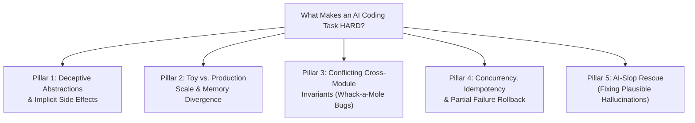

# Deep Research: What Makes an AI-Enabled Coding Interview Truly "HARD"?

## 1. Why Traditional "LeetCode Hard" Is Obsolete in AI Interviews

In a traditional coding interview without AI, a problem is **Hard** if it requires recalling an obscure algorithm (e.g., Tarjan's strongly connected components, Dinic's max flow, or a 3D dynamic programming recurrence) and typing 80 lines of bug-free code from memory in 40 minutes.

In an **AI-Enabled Coding Interview**, a candidate can paste a classic LeetCode Hard prompt into GPT, Claude, or Gemini and get a working $O(N \log N)$ implementation in **4 seconds**.

Therefore, **algorithmic obscurity no longer creates difficulty.**  
Research across industry benchmarks (**Meta AI-Enabled SWE loops**, **Stripe Bug Bash / Integration loops**, **Canva AI-Assisted Challenges**, and academic benchmarks like **SWE-bench Verified** and **Multi-SWE-bench**) reveals what actually separates a Senior/Staff engineer from a "Vibe-Coder" when both have access to the same LLM:

> **In an AI-enabled world, a task is HARD when the context spans multiple files with unwritten invariants, scale/concurrency constraints, and "Compounding AI Traps" where naive prompting produces code that looks 100% plausible—and even passes toy tests—but fails catastrophically on edge cases, production scale, or cross-module integration.**

---

## 2. The 5 Taxonomy Pillars of "Hard" AI-Enabled Tasks

Every case in our **[Hard Tier (`cases/hard/`)](../cases/hard/README.md)** is built on real open-source GitHub repositories and combines at least **three** of the following five pillars:

### Pillar 1: Deceptive Abstractions & Implicit Side Effects
- **Mechanism**: A helper function or class method in File A has a clean name (e.g., `normalize_headers()`, `validate_schema()`, or `get_cached_session()`), so an LLM assumes it is a pure function. In reality, it mutates a shared dictionary in-place, strips case-sensitivity required downstream, or triggers lazy I/O.
- **Why AI Fails**: Unless the engineer traces File A before prompting File B, the AI calls the helper in a loop and silently corrupts state.
- **Competencies Stress-Tested**: *Criterion #4 (Code Reading Speed)*, *Criterion #2 (Prompt Context)*, *Criterion #3 (Not Blindly Trusting AI)*.

### Pillar 2: Toy-vs-Production Scale & Memory Divergence
- **Mechanism**: The workspace provides both a tiny development fixture (e.g., 30 items in `get_test_dictionary()`) and a realistic production fixture or benchmark test (e.g., 50,000 words, 100MB stream, or 10,000 nested JSON nodes).
- **Why AI Fails**: By default, LLMs optimize for brevity and readability, generating $O(N^2)$ string concatenations, full-list copies per iteration, or unbounded recursion. The code passes the toy test in `5ms` and times out or hits `RecursionError` / OOM on the production test.
- **Competencies Stress-Tested**: *Criterion #1 (Problem Decomposition)*, *Criterion #6 (Testing Before Claiming Done)*, *Criterion #7 (Explaining Correctness & Complexity)*.

### Pillar 3: Conflicting Cross-Module Invariants ("Whack-a-Mole" Regression Risk)
- **Mechanism**: Module X relies on an implicit ordering, tie-breaking, or error-propagation contract from Module Y. Fixing a bug in Module Y in the most "obvious" way (which the AI always suggests first) breaks Module Z's downstream parser or serializer.
- **Why AI Fails**: When a candidate prompts *"Fix failing test A"*, the AI changes Module Y and breaks test B. When the candidate pastes the failure of test B, the AI reverts Module Y and breaks test A again—trapping blind copy-pasters in an infinite loop.
- **Competencies Stress-Tested**: *Criterion #1 (Divide & Conquer)*, *Criterion #4 (Codebase Navigation)*, *Criterion #5 (Bug & Edge-Case Discovery)*.

### Pillar 4: Concurrency, Idempotency & Partial Failure State Corruption
- **Mechanism**: Tasks involving async retry loops, connection pools, distributed rate limiters, event streams, or transactional state machines where two concurrent requests or a mid-flight exception leave the system in a half-mutated state.
- **Why AI Fails**: LLMs routinely write happy-path `async/await` or mutex code that holds locks across network I/O, forgets idempotency keys on retries, leaks file descriptors on cancellation, or fails to roll back partial state on error.
- **Competencies Stress-Tested**: *Criterion #3 (AI Skepticism)*, *Criterion #5 (Edge-Case Discovery)*, *Criterion #7 (Solution Defense)*.

### Pillar 5: "AI-Slop" Legacy Rescue (Auditing & Rewriting Plausible Hallucinations)
- **Mechanism**: The starting branch contains a feature or PR previously written by a developer who blindly trusted an LLM. The code is verbose, well-commented, and passes 80% of happy-path tests, but contains 3–4 intertwined logic flaws, over-mocked tests that assert nothing, or subtle security/validation bypasses.
- **Why AI Fails**: When you ask an LLM *"What's wrong with this code?"*, it is often fooled by its own plausible style and flattering comments! The human engineer must trace the logic from first principles, delete the dead/broken AI abstractions, and rebuild cleanly.
- **Competencies Stress-Tested**: *All 7 Criteria—especially #3 (Not Blindly Trusting AI) and #5 (Bug & Edge-Case Discovery)*.

---

## 3. Comparison Matrix: Easy vs. Medium vs. Hard Calibration

| Dimension | Easy Tier (`cases/easy/`) | Medium Tier (`cases/medium/`) | Hard Tier (`cases/hard/`) |
| :--- | :--- | :--- | :--- |
| **Target Duration** | 30–45 minutes | 45–60 minutes (Meta Standard) | 60–75 minutes (Senior / Staff) |
| **Files Involved** | 2–4 files (1 core module + 1 test file) | 5–7 files across 2–3 modules | 7–15+ files in a real production OSS codebase |
| **Seeded / Existing Bugs** | 1–2 localized logic bugs | 2–3 interacting bugs across modules | 3+ subtle bugs involving state, scale, concurrency, or invariants |
| **AI Trap Complexity** | **Single Trap**: Duplicate elements, boundary off-by-one, or basic $O(N^2)$ loop. | **Dual Trap**: Naive prompt breaks an interface contract or fails on the production dataset. | **Compounding Traps**: Fixing Bug A naively breaks Module B; requires architectural decomposition before prompting. |
| **Source GitHub Repos** | Polyglot Refactoring Katas (`@emilybache`, Coding Dojo) | Contained Apps, Solvers, Micro-Libraries (`RealWorld`, `ky`, `hono`, etc.) | Production OSS Libraries & `Multi-SWE-bench` commits (`httpx`, `zod`, `cobra`, `gson`, `serde_json`, `pydantic`, `rich`, `bubbletea`) |

---

## 4. Summary of the 10 Hard Cases in This Repository

To give HR and Senior/Staff engineers a complete, polyglot benchmark, our **[10 Hard Cases](../cases/hard/README.md)** span 5 programming languages and all 5 Hard Taxonomy Pillars:

| Case ID | Standalone Case Page | Source GitHub Repo | Languages | Primary AI Traps Tested |
| :--- | :--- | :--- | :--- | :--- |
| **[H01](../cases/hard/H01-httpx-redirect-pool.md)** | [Async HTTP Connection Pool & Redirect Auth-Leak](../cases/hard/H01-httpx-redirect-pool.md) | [`encode/httpx`](https://github.com/encode/httpx) | `Python` | Concurrency/Locking + Cross-Module Security Invariant |
| **[H02](../cases/hard/H02-zod-cyclic-schema.md)** | [Recursive Schema Validation & Cyclic Type Inference](../cases/hard/H02-zod-cyclic-schema.md) | [`colinhacks/zod`](https://github.com/colinhacks/zod) | `TypeScript` | Toy-vs-Prod Scale + Mutated Parse Context State |
| **[H03](../cases/hard/H03-bubbletea-event-loop.md)** | [Concurrent TUI Event Loop & Command Batching Race](../cases/hard/H03-bubbletea-event-loop.md) | [`charmbracelet/bubbletea`](https://github.com/charmbracelet/bubbletea) | `Go` | Goroutine Channel Deadlock + Order-of-Delivery Invariant |
| **[H04](../cases/hard/H04-gson-polymorphic-adapter.md)** | [Polymorphic JSON TypeAdapter & Number Precision Loss](../cases/hard/H04-gson-polymorphic-adapter.md) | [`google/gson`](https://github.com/google/gson) | `Java` | Reflection Cache Poisoning + Conflicting Type Contracts |
| **[H05](../cases/hard/H05-serde-streaming-json.md)** | [Zero-Copy Streaming Deserializer & Buffering Boundary](../cases/hard/H05-serde-streaming-json.md) | [`serde-rs/json`](https://github.com/serde-rs/json) | `Rust` | Borrow-Checker Lifetime Trap + Streaming Buffer Boundary |
| **[H06](../cases/hard/H06-pydantic-validator-mro.md)** | [Model Validator Inheritance MRO & Default Factory Leak](../cases/hard/H06-pydantic-validator-mro.md) | [`pydantic/pydantic`](https://github.com/pydantic/pydantic) | `Python` | Deceptive Metaclass Abstraction + Shared Mutable Defaults |
| **[H07](../cases/hard/H07-tanstack-optimistic-query.md)** | [Async Query Cache Deduplication & Optimistic Rollback](../cases/hard/H07-tanstack-optimistic-query.md) | [`TanStack/query`](https://github.com/TanStack/query) | `TypeScript` | Out-of-Order Promise Cancellation + Stale Closure Trap |
| **[H08](../cases/hard/H08-cobra-flag-propagation.md)** | [Hierarchical CLI Flag Propagation & Hook Shadowing](../cases/hard/H08-cobra-flag-propagation.md) | [`spf13/cobra`](https://github.com/spf13/cobra) | `Go` | Parent-Child Tree Traversal + Backwards-Compatibility Contract |
| **[H09](../cases/hard/H09-rich-wide-char-table.md)** | [ANSI Wide-Character Table Layout & Wrapping Perf Cliff](../cases/hard/H09-rich-wide-char-table.md) | [`Textualize/rich`](https://github.com/Textualize/rich) | `Python` | Unicode Cell-Width Trap + $O(N^2)$ Measurement Bottleneck |
| **[H10](../cases/hard/H10-legacy-billing-ai-slop-rescue.md)** | [Legacy Rule Engine & Tax Calculation "AI-Slop" Rescue](../cases/hard/H10-legacy-billing-ai-slop-rescue.md) | [`emilybache/GildedRose-Refactoring-Kata`](https://github.com/emilybache/GildedRose-Refactoring-Kata) + [`Theatrical-Players`](https://github.com/emilybache/Theatrical-Players-Refactoring-Kata) | `Python`, `TS`, `Go`, `Java`, `Rust`, `C#` | AI-Slop Hallucinated PR Rescue + Multi-Currency Rounding Invariants |
