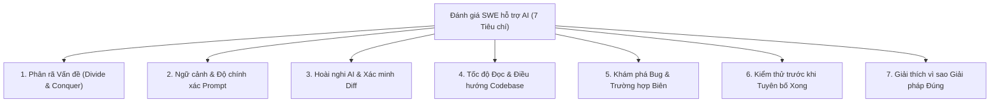

> 🌐 Ngôn ngữ: <a href="01-THE-7-EVALUATION-CRITERIA">English</a> · **Tiếng Việt**

# 7 Tiêu chí Đánh giá của Phỏng vấn Lập trình hỗ trợ AI

Trong các buổi phỏng vấn thuật toán truyền thống (kiểu LeetCode), người phỏng vấn đánh giá khả năng nhớ cú pháp và các mẫu cấu trúc dữ liệu đã thuộc lòng trên một file trống. Trong **Phỏng vấn SWE hỗ trợ AI hiện đại** (được các công ty như Meta, Canva và Stripe sử dụng), ứng viên có toàn quyền truy cập các LLM tiên tiến (Claude, GPT, Gemini) trong một codebase nhiều file.

Khi AI có thể sinh cú pháp trong vài giây, **tốc độ gõ không còn là tín hiệu—phán đoán kỹ thuật và khả năng kiểm soát AI mới là.**

Mỗi bài toán phỏng vấn trong kho này được thiết kế để đánh giá **7 Năng lực Kỹ thuật Cốt lõi**.

---

## Tổng quan: 7 Năng lực Tóm tắt

---

## Phân tích Chi tiết & Thang điểm Hành vi 1–4

### 1. Phân rã Vấn đề (_Cách Bạn Chia Nhỏ Vấn đề_)

> **Câu hỏi Cốt lõi:** Kỹ sư có chia một yêu cầu phức tạp nhiều giai đoạn thành các bài toán con nhỏ, kiểm soát được (_Divide and Conquer_), hay đổ toàn bộ yêu cầu vào AI một lần?

| Điểm                        | Neo Hành vi                                                                                                                                                       |
| :-------------------------- | :---------------------------------------------------------------------------------------------------------------------------------------------------------------- |
| **1 (Vibe-Coder Mù)**       | Copy-paste toàn bộ mô tả bài toán vào prompt AI và yêu cầu giải pháp end-to-end trong một lần.                                                                    |
| **2 (Phân rã Yếu)**         | Chỉ chia nhỏ khi output khổng lồ của AI không biên dịch hoặc không qua test; thiếu kế hoạch ban đầu.                                                              |
| **3 (Điều phối Viên Vững)** | Tách rõ khám phá, sửa bug, logic lõi và tối ưu thành các bước tuần tự; khóa phạm vi trước khi prompt.                                                             |
| **4 (Bội số Lực lượng)**    | Phân rã theo các đường nối kiến trúc sạch (interface, hợp đồng dữ liệu, chuyển trạng thái), giữ mình là kiến trúc sư và chỉ dùng AI cho các tác vụ lá có phạm vi. |

---

### 2. Ngữ cảnh & Độ chính xác Prompt (_Prompt của Bạn có Đủ Ngữ cảnh?_)

> **Câu hỏi Cốt lõi:** Kỹ sư có biết _muốn_ AI làm gì và _vì sao_ trước khi prompt, cung cấp đúng đường dẫn file, ràng buộc và bất biến?

| Điểm                               | Neo Hành vi                                                                                                                                                                      |
| :--------------------------------- | :------------------------------------------------------------------------------------------------------------------------------------------------------------------------------- |
| **1 (Mơ hồ / Không ngữ cảnh)**     | Prompt như _"Sửa bug trong solver"_ hoặc _"Làm test pass"_ mà không chỉ rõ hàm mục tiêu, kiểu dữ liệu hay bất biến.                                                              |
| **2 (Thiếu chi tiết)**             | Cung cấp ngữ cảnh một phần; bỏ sót ràng buộc quan trọng (giới hạn hiệu năng, bất biến, hàm helper có sẵn), khiến AI phát minh lại hoặc phá module.                               |
| **3 (Giàu ngữ cảnh & Có phạm vi)** | Chỉ rõ tên file chính xác, chữ ký hàm, hợp đồng vào/ra và những gì _không_ được chạm (`"Chỉ cập nhật Puzzle.guess() trong puzzle.py; giữ nguyên hợp đồng Match enum"`).          |
| **4 (Prompt Phẫu thuật)**          | Dùng prompt hai pha có cấu trúc: trước tiên yêu cầu AI ánh xạ/xác minh ngữ cảnh, sau đó phát micro-prompt chặt chẽ với bất biến trường hợp biên và mục tiêu độ phức tạp rõ ràng. |

---

### 3. Không Tin mù quáng AI (_Hoài nghi AI & Xác minh Diff_)

> **Câu hỏi Cốt lõi:** Kỹ sư có coi output AI như một Pull Request chưa tin cậy từ một junior nhanh nhưng hay sai—đọc từng dòng diff và chất vấn giả định ẩn?

| Điểm                            | Neo Hành vi                                                                                                                                                      |
| :------------------------------ | :--------------------------------------------------------------------------------------------------------------------------------------------------------------- |
| **1 (Tin mù quáng)**            | Nhấn "Accept/Apply" hoặc copy code AI thẳng vào editor mà không đọc; rơi vào mọi Bẫy AI đã gieo sẵn.                                                             |
| **2 (Lướt bề mặt)**             | Liếc qua code AI xem có hợp lệ về cú pháp, nhưng bỏ sót bug logic tinh vi, lỗi off-by-one hoặc trạng thái dùng chung bị đột biến cho đến khi test nổ.            |
| **3 (Kiểm toán Viên Phê phán)** | Đọc từng dòng diff AI trước khi chạy; hỏi AI _"Bạn đã giả định gì về X?"_ và từ chối các đoạn quá mức hoặc có bug.                                               |
| **4 (Người rà soát Đối kháng)** | Ngay lập tức nhận ra nơi LLM ảo hóa một bất biến hoặc dùng thuật toán ngây thơ; ghi đè hoặc viết lại các phần dễ bị tổn thương trước khi chúng chạm test runner. |

---

### 4. Tốc độ Đọc Code (_Bạn Đọc Code Người Khác Nhanh thế nào_)

> **Câu hỏi Cốt lõi:** Kỹ sư định hướng trong một repo 5–15 file do người khác viết nhanh đến đâu, theo dõi điểm vào, phụ thuộc module và test harness?

| Điểm                           | Neo Hành vi                                                                                                                                                      |
| :----------------------------- | :--------------------------------------------------------------------------------------------------------------------------------------------------------------- |
| **1 (Lạc trong Repo)**         | Mất 15+ phút click ngẫu nhiên file hoặc dựa hoàn toàn vào AI mà không mở source để xác minh cách dự án được nối.                                                 |
| **2 (Chậm / Phân mảnh)**       | Đọc file từ trên xuống dưới theo từng dòng mà không theo đồ thị gọi; bỏ sót nơi fixture `data/` hoặc test helper nối với `src/`.                                 |
| **3 (Người điều hướng Nhanh)** | Dùng AI chiến lược để ánh xạ kiến trúc trước, sau đó nhảy thẳng đến điểm vào, lớp domain lõi và unit test trong 5–10 phút.                                       |
| **4 (Người đọc Code Tia X)**   | Theo dõi luồng thực thi qua các module nhanh, xác định tác dụng phụ ẩn và phát hiện mùi kiến trúc hoặc sai lệch giữa docstring và implementation trong vài phút. |

---

### 5. Khám phá Bug & Trường hợp Biên (_Cách Bạn Tìm Bug và Trường hợp Biên_)

> **Câu hỏi Cốt lõi:** Kỹ sư có chẩn đoán nguyên nhân gốc trong code legacy hỏng và chủ động phát hiện điều kiện biên (trùng lặp, input rỗng, race concurrency, nút thắt quy mô)?

| Điểm                                 | Neo Hành vi                                                                                                                                                                                    |
| :----------------------------------- | :--------------------------------------------------------------------------------------------------------------------------------------------------------------------------------------------- |
| **1 (Vá Triệu chứng)**               | Không tìm được bug nếu không paste log lỗi vào AI; áp dụng kiểm tra `if` chắp vá hardcode quanh input test đang fail.                                                                          |
| **2 (Chỉ Đường vui)**                | Sửa bug rõ ràng do test fail có sẵn, nhưng bỏ sót bug thứ cấp hoặc trường hợp biên (ví dụ chữ cái trùng trong Wordle, payload `null`/rỗng, tràn số nguyên).                                    |
| **3 (Người gỡ lỗi Nguyên nhân gốc)** | Theo dõi trạng thái từng bước, cô lập nguyên nhân gốc chính xác của bug đã gieo và liệt kê có hệ thống các điều kiện biên trước khi tiếp tục.                                                  |
| **4 (Thợ săn Trường hợp Biên)**      | Chủ động xác định các chế độ thất bại không rõ ràng (phân kỳ toy vs production dataset, cache poisoning, race condition, rollback thất bại một phần) và prompt AI cụ thể để stress-test chúng. |

---

### 6. Kiểm thử trước khi Tuyên bố Xong (_Độ Nghiêm ngặt Xác minh_)

> **Câu hỏi Cốt lõi:** Kỹ sư có chạy test hiện có sau mỗi thay đổi nhỏ và viết unit test mới cho bug đã sửa và trường hợp biên _trước_ khi tuyên bố một checkpoint hoàn thành?

| Điểm                               | Neo Hành vi                                                                                                                                           |
| :--------------------------------- | :---------------------------------------------------------------------------------------------------------------------------------------------------- |
| **1 (Xong chưa xác minh)**         | Tuyên bố task hoàn thành ngay khi code được paste, không chạy test suite hay kiểm tra output chương trình.                                            |
| **2 (Người test Thủ công / Muộn)** | Chỉ chạy test ở cuối buổi phỏng vấn, hoặc chỉ dựa vào nút `main` mặc định mà không chạy unit test suite (`test_*.py`) hay bỏ comment test bị tắt.     |
| **3 (Người xác minh Test-Driven)** | Chạy test suite ở baseline, sau mỗi micro-change, và bỏ comment/thêm unit test cho logic vừa implement trước khi sang checkpoint tiếp theo.           |
| **4 (Người bảo vệ Regression)**    | Viết test regression nhắm mục tiêu _trước_ hoặc song song với bản sửa, test trên cả toy và production dataset, và xác minh giới hạn hiệu năng/bộ nhớ. |

---

### 7. Giải thích vì sao Giải pháp Đúng (_Quyền Sở hữu Kỹ thuật & Bảo vệ_)

> **Câu hỏi Cốt lõi:** Kỹ sư có giải thích rõ ràng giải pháp end-to-end, bảo vệ độ phức tạp và đánh đổi kiến trúc, và chứng minh không có regression nào được đưa vào?

| Điểm                              | Neo Hành vi                                                                                                                                                  |
| :-------------------------------- | :----------------------------------------------------------------------------------------------------------------------------------------------------------- |
| **1 (Không sở hữu)**              | Không giải thích được thuật toán AI sinh ra hoạt động thế nào; nói _"Đó là gợi ý của AI và test đã pass."_                                                   |
| **2 (Giải thích Bề mặt)**         | Tóm tắt cấp cao code làm gì theo từng dòng, nhưng gặp khó khi được hỏi _"Điều gì xảy ra nếu input X scale 100x?"_ hoặc _"Vì sao chọn cấu trúc dữ liệu này?"_ |
| **3 (Chủ sở hữu Rõ ràng)**        | Trình bày bài toán, nguyên nhân gốc của bug, vì sao thuật toán chọn là đúng, độ phức tạp thời gian/không gian và cách xử lý trường hợp biên.                 |
| **4 (Người giao tiếp Mức Staff)** | Kể lại quyết định ngắn gọn suốt buổi; kết thúc bằng walkthrough kiến trúc súc tích bao phủ bất biến, rủi ro regression, đánh đổi và mức sẵn sàng production. |

---

## Tóm tắt: Vì sao "Copy-Paste Nhanh" Thất bại với Rubric này

Nếu ứng viên chỉ copy mô tả bài toán vào trợ lý AI và chấp nhận code được sinh:

- Họ có thể hoàn thành **Checkpoint 1 hoặc 2 nhanh chóng** trên bài Easy.
- Tuy nhiên, họ đạt **1/4 ở Tiêu chí #1, #2, #3 và #7**, và ngay khi gặp **Bẫy AI Medium hoặc Hard**, họ bị kẹt trong vòng lặp "prompt thrashing" nơi AI liên tục phá một test khi sửa test khác.
- Quy trình **Divide-and-Conquer (`Understand → Plan → Prompt → Review → Test`)** được tài liệu hóa trong [02-EMPLOYEE-MINDSET-AND-PROMPT-PLAYBOOK.md](02-EMPLOYEE-MINDSET-AND-PROMPT-PLAYBOOK.md) được thiết kế cụ thể để tối đa hóa cả 7 tiêu chí.
