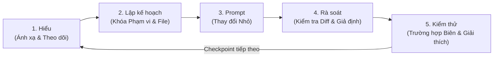

# Tư duy Nhân viên & Sổ tay Prompt: Divide and Conquer

> **Quy tắc Vàng của Phỏng vấn hỗ trợ AI:**  
> Bạn phải biết **muốn** AI làm gì và **vì sao** _trước_ khi viết prompt.  
> Nếu paste mô tả bài toán và chấp nhận mù quáng code được sinh, bạn có thể nhanh trong 5 phút—nhưng người phỏng vấn sẽ thấy **không có phán đoán kỹ thuật**, và bạn sẽ đi thẳng vào các **Bẫy AI** đã gieo sẵn.

Sổ tay này cho bạn mô hình tư duy, quy trình thực thi 5 bước và **các mẫu prompt viết sẵn** có thể thuộc lòng và điều chỉnh trong bất kỳ buổi phỏng vấn lập trình hỗ trợ AI hay tác vụ kỹ thuật thực tế.

---

## 1. Tư duy Cốt lõi: Divide and Conquer (Chia nhỏ Quyền kiểm soát)

Trong phỏng vấn hỗ trợ AI, hãy xem mình là **Tech Lead / Kiến trúc sư Staff** và trợ lý AI là **một junior nhanh nhưng liều lĩnh** chưa từng thấy bất biến production của bạn.

| Trách nhiệm                                             |       Ai sở hữu?       | Vì sao?                                                                      |
| :------------------------------------------------------ | :--------------------: | :--------------------------------------------------------------------------- |
| **Ánh xạ kiến trúc & đọc test**                         | **Bạn + AI (Chỉ đọc)** | AI tóm tắt nhanh, nhưng bạn phải xác minh điểm vào và hợp đồng test.         |
| **Định nghĩa phạm vi, thiết kế & file mục tiêu**        |      **100% Bạn**      | Không bao giờ để AI quyết định module hay public interface nào cần viết lại. |
| **Viết boilerplate cục bộ / diff nhỏ**                  | **AI (Bạn hướng dẫn)** | Prompt từng thay đổi nhỏ, có thể xác minh thay vì cả tính năng.              |
| **Rà soát diff & chất vấn giả định**                    |      **100% Bạn**      | Bắt lỗi off-by-one, trạng thái đột biến và bẫy $O(N^2)$ trước khi chạy code. |
| **Kiểm thử trường hợp biên & giải thích tính đúng đắn** |      **100% Bạn**      | Bạn sở hữu mọi dòng đã commit và phải bảo vệ vì sao giải pháp hợp lý.        |

---

## 2. Vòng lặp Thực thi 5 Bước

Mỗi checkpoint trong buổi phỏng vấn nên theo đúng vòng lặp này:



---

## 3. Thư viện Prompt Viết sẵn (Thuộc lòng & Điều chỉnh trước Buổi phỏng vấn)

Dưới đây là các mẫu prompt đã qua thực chiến cho mỗi giai đoạn của quy trình **Divide and Conquer**.

### Giai đoạn 1: `Understand` — Ánh xạ Cấu trúc & Theo dõi Luồng Thực thi

_Mục tiêu: Định hướng trong codebase nhiều file xa lạ trong dưới 5 phút mà chưa để AI viết bất kỳ code nào._

#### Prompt 1A: Bộ ánh xạ Kiến trúc & Đồ thị Gọi

```text
Chưa viết hay sửa bất kỳ code nào.
Đọc các file trong workspace này và cho tôi bản đồ kiến trúc súc tích:
1. Điểm vào và cách chương trình/test được chạy.
2. Các lớp/hàm domain lõi trong `src/` và trách nhiệm của chúng.
3. Cách dữ liệu chảy từ input/fixtures (`data/`) qua logic lõi đến output.
4. Bất kỳ test bị comment, TODO hoặc xử lý trường hợp biên đáng ngờ trong `test_*`.
Giữ câu trả lời ngắn gọn, dạng bullet với tham chiếu file:line.
```

#### Prompt 1B: Bộ theo dõi Luồng Thực thi & Bất biến

```text
Chưa đề xuất thay đổi code.
Theo dõi chính xác luồng thực thi từng bước khi `<ClassName.method_name(sample_input)>` được gọi:
1. Biến trạng thái nào được đọc hoặc đột biến?
2. Implementation hiện tại giả định gì về input (ví dụ trùng lặp, thứ tự, giá trị null/rỗng, kích thước)?
3. Logic này có thể vi phạm đặc tả trong `<INSTRUCTIONS / docstring>` ở đâu?
```

---

### Giai đoạn 2: `Plan` — Khóa Phạm vi, Thiết kế & File Mục tiêu (Chính bạn)

_Mục tiêu: Trước khi prompt để lấy code, nêu kế hoạch của bạn bằng lời với người phỏng vấn và xác minh thiết kế._

**Checklist nêu bằng lời với người phỏng vấn:**

1. _"Dựa trên test suite và `src/`, đây là đúng 1–2 file cần chạm: `[file_a]` và `[file_b]`."_
2. _"Bug hiện có trong `[file_a]` xảy ra vì `[nguyên nhân gốc]`. Tôi sẽ sửa cái đó trước và xác minh bằng unit test trước khi xây `[tính năng mới]`."_
3. _"Với `[tính năng mới]`, cách ngây thơ sẽ là $O(N^2)$ / hỏng khi có phần tử trùng, nên tôi sẽ dùng `[thuật toán/cấu trúc dữ liệu]` và yêu cầu AI implement chỉ helper function trước."_

#### Prompt 2A: Kiểm tra Sanity Thiết kế (Tùy chọn, cho Bài khó)

```text
Tôi dự định giải `<bài toán con cụ thể>` trong `<target_file>` bằng cách:
- Cấu trúc dữ liệu / trạng thái: <lựa chọn của bạn>
- Bước 1: <bước 1>
- Bước 2: <bước 2>
- Mục tiêu độ phức tạp: <ví dụ O(N) thời gian, O(K) không gian>

Chưa viết implementation. Phê bình kế hoạch của tôi trong 3 bullet:
1. Điều này có phá bất kỳ hợp đồng phương thức hoặc caller nào trong repo không?
2. Trường hợp biên nào (trùng lặp, input rỗng, quy mô, concurrency) có thể phá thiết kế này?
```

---

### Giai đoạn 3: `Prompt` — Thay đổi Nhỏ Tăng dần (Không bao giờ Dump toàn bộ Spec)

_Mục tiêu: Giữ 100% quyền kiểm soát bằng cách yêu cầu từng thay đổi nhỏ, cô lập._

#### Prompt 3A: Prompt Sửa Bug Có Phạm vi

```text
Trong `<file_path>`, `<function_name>` hiện tại hỏng khi `<mô tả trường hợp fail / nguyên nhân gốc>`.
Chỉ sửa `<function_name>` để sửa lỗi này:
- Ràng buộc 1: Giữ nguyên chữ ký hàm và kiểu trả về `<type>`.
- Ràng buộc 2: Xử lý đúng `<trường hợp biên cụ thể, ví dụ chữ cái trùng / matching hai lượt>`.
- Ràng buộc 3: Không sửa bất kỳ hàm hay file nào khác.
Cho tôi diff tối thiểu và giải thích trong 2 câu vì sao bản sửa này xử lý `<trường hợp biên>`.
```

#### Prompt 3B: Prompt Bước Tính năng / Solver Có Phạm vi

```text
Chúng ta đang implement `<Feature/Solver>` trong `<file_path>` tăng dần.
Cho bước này, implement CHỈ `<helper_or_method_name>`:
- Input: `<kiểu và bất biến chính xác>`
- Output: `<kiểu trả về chính xác>`
- Thuật toán sử dụng: `<chỉ rõ thuật toán bạn chọn, ví dụ candidate filtering by feedback mask + frequency scoring>`
- Ràng buộc hiệu năng: Phải chạy dưới `<X ms>` trên `get_prod_dictionary()` (`<N>` mục).
Không thêm dependency ngoài. Cung cấp code sạch, có kiểu cho phương thức này thôi.
```

---

### Giai đoạn 4: `Review` — Kiểm tra Diff, Chất vấn Giả định & Chạy Test

_Mục tiêu: Bắt hallucination AI và bẫy tinh vi trước khi commit thay đổi._

**Việc cần làm mỗi khi AI output code:**

1. **Đọc diff từng dòng** trước khi copy hoặc apply.
2. **Đặt Prompt Chất vấn Giả định** nếu điều gì không rõ ràng.
3. **Chạy unit test suite ngay lập tức** (`pytest`, `npm test`, `go test ./...`, v.v.).

#### Prompt 4A: Prompt Chất vấn Giả định & Bẫy

```text
Trước khi tôi apply code của bạn cho `<function_name>`, trả lời súc tích:
1. Implementation của bạn giả định ngầm gì về kích thước input, tính có thể đột biến, trùng lặp hoặc thứ tự?
2. Có input nào khiến code của bạn raise exception chưa xử lý, vào vòng lặp vô hạn hoặc vượt `<giới hạn thời gian/bộ nhớ>` không?
3. Bạn có đột biến đối số input hay trạng thái dùng chung tại chỗ không?
```

---

### Giai đoạn 5: `Test` — Trường hợp Biên, Rủi ro Regression & Giải thích Giải pháp Cuối cùng

_Mục tiêu: Chứng minh giải pháp hoạt động dưới input đối kháng và trao bản tóm tắt mức Staff cho người phỏng vấn._

#### Prompt 5A: Bộ sinh Test Trường hợp Biên Đối kháng

```text
Nhìn vào các thay đổi của chúng ta trong `<file_path>` và test suite hiện có trong `<test_file_path>`.
Đề xuất 5 unit test case có tín hiệu cao bao phủ điều kiện biên khó:
1. Input rỗng / tối thiểu
2. Phần tử trùng / lặp lại
3. Điều kiện biên / tie-breaking
4. Chuyển trạng thái không hợp lệ / sai dạng
5. Hiệu năng production-scale / stress test (`get_prod_dictionary()` / dataset lớn)
Viết hàm test theo đúng style của `<test_file_path>`.
```

#### Kịch bản Walkthrough 60 Giây Cuối (Cho Người phỏng vấn)

Ở cuối buổi phỏng vấn (Phút 55–60), tóm tắt công việc mà không chờ được hỏi:

1. **Nguyên nhân gốc Đã sửa**: _"Ở Checkpoint 2, bug hiện có do `[X]`, fail trên `[trường hợp biên]`. Chúng tôi sửa bằng `[Y]` và thêm test regression."_
2. **Kiến trúc Lõi**: _"Ở Checkpoint 3, chúng tôi cấu trúc `[Solver/Feature]` dùng `[thiết kế]`, đạt `O(...)` thời gian và `O(...)` không gian nên scale sạch từ toy fixture đến production dataset."_
3. **Rào chắn AI Đã áp dụng**: _"Trong quá trình implement, AI ban đầu gợi ý `[cách ngây thơ / bug]`, tôi từ chối/sửa vì `[lý do]`."_
4. **Sẵn sàng Production & Bước tiếp theo**: _"Nếu ship cái này lên production, điều tiếp theo tôi sẽ thêm là `[observability / streaming / concurrency lock / property-based tests]`."_

---

## 4. Các Anti-Pattern Phổ biến Cần Tránh Tuyệt đối

| Anti-Pattern                | Người phỏng vấn Thấy gì                                                                                  | Nên làm gì Thay thế                                                                                                               |
| :-------------------------- | :------------------------------------------------------------------------------------------------------- | :-------------------------------------------------------------------------------------------------------------------------------- |
| **The Silent Copy-Paster**  | Bạn paste prompt, im lặng 3 phút, paste 150 dòng code AI, nhấn Run.                                      | Kể kế hoạch bằng lời _trước_ khi prompt: _"Tôi đang yêu cầu AI soạn chỉ filter helper trong khi tôi kiểm tra test cases."_        |
| **Prompt Thrashing**        | Test fail; bạn paste stack trace vào AI với _"Vẫn hỏng, sửa đi"_ 4 lần liên tiếp.                        | Dừng prompt! Đọc assertion test fail, tự in/trace giá trị thực tế vs kỳ vọng, tìm nguyên nhân gốc, rồi mới phát prompt chính xác. |
| **Scope Creep Refactoring** | AI viết lại 5 hàm không liên quan, đổi format hoặc alter chữ ký public API.                              | Từ chối diff ngay lập tức. Nói với AI: _"Hoàn tác thay đổi không liên quan; chỉ sửa dòng X–Y trong `target_func`."_               |
| **Toy-Dataset Complacency** | Pass `get_test_dictionary()` (30 từ) và giả định xong mà không test `get_prod_dictionary()` (50.000 từ). | Luôn test cả fixture nhỏ và production dataset trước khi tuyên bố xong.                                                           |
