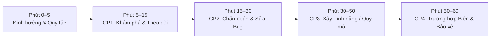

> 🌐 Ngôn ngữ: <a href="03-HR-AND-INTERVIEWER-RUNBOOK">English</a> · **Tiếng Việt**

# Sổ tay HR & Người phỏng vấn: Điều hành Phỏng vấn Lập trình hỗ trợ AI

Sổ tay này trang bị cho **Chuyên viên HR / Talent Acquisition**, **Engineering Manager** và **Người phỏng vấn Kỹ thuật** để điều hành nhất quán các buổi phỏng vấn SWE lập trình hỗ trợ AI 60 phút chất lượng cao, dùng các bài toán GitHub mã nguồn mở trong kho này.

---

## 1. Cách Các Hãng Hàng đầu Điều hành Phỏng vấn hỗ trợ AI

| Chuẩn Hãng                              | Môi trường & Công cụ                                                                                                              | Tín hiệu Chính được Đánh giá                                                                                               |
| :-------------------------------------- | :-------------------------------------------------------------------------------------------------------------------------------- | :------------------------------------------------------------------------------------------------------------------------- |
| **Meta** (_Vòng SWE hỗ trợ AI_)         | Phiên CoderPad 60 phút với workspace nhiều file (`src/`, `data/`, `test_*`) + trợ lý AI tích hợp (Claude / GPT / Gemini / Llama). | Điều hướng codebase hiện có, bỏ comment/sửa test, giải quyết bug đã gieo, implement solver/tính năng và kiểm toán diff AI. |
| **Canva** (_Vòng Thực hành hỗ trợ AI_)  | IDE cục bộ (Cursor, VS Code + Copilot, Claude) hoặc repo sandbox trên module sản phẩm/backend thực tế.                            | Prompt chiến lược, xác định phạm vi yêu cầu, chất lượng code sẵn sàng PR và bảo vệ đánh đổi kiến trúc.                     |
| **Stripe** (_Vòng Bug Bash & Tích hợp_) | Repo nhiều file hiện có với quy tắc nghiệp vụ phức tạp, parsing hoặc state machine + chat AI.                                     | Đọc đặc tả cẩn thận, bắt các trường hợp biên tinh vi mà AI bỏ sót và viết test regression trước khi tuyên bố xong.         |

---

## 2. Thiết lập Workspace Trước Buổi phỏng vấn (5 Phút trước Phiên)

Vì các bài của chúng ta dùng **các GitHub repo mã nguồn mở thực tế**, bạn phải chuẩn bị **baseline clean-room** để ứng viên (hoặc agent AI của họ!) không thể chạy `git log`, `git blame` hay `git show` để tra cứu bản sửa lịch sử.

### Thiết lập Clean-Room Từng bước

```bash
# 1. Clone GitHub repo mục tiêu từ Case Blueprint
git clone <REPO_URL> candidate-session
cd candidate-session

# 2. Checkout đúng commit hoặc tag được chỉ định trong Case Blueprint
git checkout <COMMIT_SHA_OR_TAG>

# 3. Áp dụng thiết lập bug gieo sẵn / test bị comment ghi trong Case Blueprint (nếu có)

# 4. QUAN TRỌNG: Xóa lịch sử git để `git log` / `git diff` không leak lời giải!
rm -rf .git
git init
git add .
git commit -m "Initial interview workspace baseline"
```

> **Pro Tip cho CoderPad / HackerRank / Codespaces:**  
> Upload thư mục đã stripped một lần như **Reusable Custom Pad / Template** cho mỗi ngôn ngữ (`Python`, `TypeScript`, `Go`, `Java`, `Rust`) và paste Mục 2 (_Candidate Instructions_) của Case Blueprint vào panel `INSTRUCTIONS.md`.

---

## 3. Lịch 60 Phút & Kịch bản Buổi phỏng vấn



### Phút 0–5: Chào mừng & Quy tắc Cơ bản

Đọc hoặc diễn đạt lại kịch bản này để đặt kỳ vọng rõ ràng:

> _"Chào mừng! Buổi phiên 60 phút hôm nay mô phỏng cách chúng ta kỹ thuật phần mềm trong thực tế. Bạn có một codebase nhiều file, một unit test suite và toàn quyền truy cập Trợ lý AI. Bạn có thể dùng AI nhiều hay ít tùy thích. Tuy nhiên, tôi đánh giá **phán đoán kỹ thuật** của bạn—cách bạn khám phá code, chia nhỏ bài toán, xác minh thứ AI sinh ra, kiểm thử trường hợp biên và giải thích vì sao giải pháp của bạn đúng. Hãy nghĩ to để tôi theo dõi lý luận của bạn."_

### Phút 5–15: Checkpoint 1 — Khám phá & Theo dõi

- **Ứng viên Nên làm**: Mở file, chạy entrypoint chính, chuyển sang test runner, bỏ comment các unit test bị comment, và ánh xạ luồng.
- **Người phỏng vấn Quan sát**:
  - _Green Flag_: Ứng viên đọc `src/` và `test_*` (hoặc yêu cầu AI tóm tắt kiến trúc chỉ đọc) _trước_ khi yêu cầu AI sửa code.
  - _Red Flag_: Ứng viên ngay lập tức copy `INSTRUCTIONS.md` vào chat AI mà không mở bất kỳ source file nào.

### Phút 15–30: Checkpoint 2 — Chẩn đoán & Sửa Bug Đã gieo

- **Ứng viên Nên làm**: Xác định vì sao unit test fail và sửa bug(s) nền trong module hiện có.
- **Câu hỏi Thăm dò của Người phỏng vấn**:
  - _"Trước khi apply bản sửa AI đó, bạn có thể walkthrough vì sao code gốc fail trên input đó không?"_

### Phút 30–50: Checkpoint 3 — Implement Tính năng Lõi / Mục tiêu Quy mô

- **Ứng viên Nên làm**: Implement solver lõi, mở rộng tính năng hoặc tối ưu quy mô production.
- **Người phỏng vấn Quan sát**:
  - Ứng viên có dùng **Divide and Conquer** (prompt từng helper/bước), hay dump toàn bộ yêu cầu và chấp nhận diff hallucination 150 dòng?
  - Họ phản ứng thế nào khi gặp **Bẫy AI** của bài?

### Phút 50–60: Checkpoint 4 — Trường hợp Biên, Kiểm tra Regression & Bảo vệ

- **Ứng viên Nên làm**: Chạy full test suite trên cả toy và production fixtures, thêm test biên và giải thích giải pháp.
- **Câu hỏi Stress-Test Bắt buộc của Người phỏng vấn** (Chọn 2):
  1. _"AI đã giả định gì trong `<function_name>` mà bạn phải xác minh hoặc thay đổi?"_
  2. _"Độ phức tạp thời gian và bộ nhớ của bạn thay đổi thế nào nếu dataset tăng 100x?"_
  3. _"Nếu teammate submit diff này trong Pull Request, bạn sẽ yêu cầu họ thêm test cho trường hợp biên nào?"_

---

## 4. Hiệu chỉnh Cấp độ: Junior vs Mid vs Senior / Staff

Bạn có thể dùng **cùng một bài** cho nhiều cấp kỹ thuật hoặc chọn từ các tier `Easy`, `Medium` và `Hard`:

| Cấp Mục tiêu                | Tier Bài Đề xuất                 | Thanh Qua (Checkpoint + Trung bình 7 Tiêu chí)                                                                                                                                          |
| :-------------------------- | :------------------------------- | :-------------------------------------------------------------------------------------------------------------------------------------------------------------------------------------- |
| **Junior (L3)**             | **Easy** (hoặc Medium với gợi ý) | Hoàn thành Checkpoint 1–3; Điểm trung bình `>= 2.7`; chứng minh xác minh test cơ bản và giải thích được mọi dòng code AI giữ lại.                                                       |
| **Mid-Level (L4)**          | **Medium**                       | Hoàn thành Checkpoint 1–3 + Checkpoint 4 cơ bản trong 60 phút; Điểm trung bình `>= 3.0`; bắt Bẫy AI chính với gợi ý tối thiểu.                                                          |
| **Senior (L5)**             | **Medium** hoặc **Hard**         | Hoàn thành cả 4 Checkpoint sạch; Điểm trung bình `>= 3.3` (không điểm nào dưới 3); chủ động phân rã prompt, bắt Bẫy AI trước hoặc ngay khi chạy test và viết test trường hợp biên mạnh. |
| **Staff / Principal (L6+)** | **Hard**                         | Hoàn thành cả 4 Checkpoint trong repo production phức tạp (`Hard`); Điểm trung bình `>= 3.6`; xác định bất biến cross-module, rủi ro concurrency/quy mô và đánh đổi kiến trúc dễ dàng.  |

---

## 5. Giao thức Debrief & Chấm điểm

1. Ngay sau buổi phỏng vấn, điền **[Mẫu Scorecard Ứng viên](../../templates/vi/SCORECARD_TEMPLATE.md)**.
2. **Quy tắc Veto Tự động**: Điểm **`1` ở Tiêu chí #3 (_Không Tin mù quáng AI_)** hoặc **`1` ở Tiêu chí #6 (_Kiểm thử trước khi Tuyên bố Xong_)** giới hạn khuyến nghị tổng thể ở mức **No Hire**, ngay cả khi test cuối cùng pass nhờ may mắn. Vì sao? Một kỹ sư commit code AI chưa xác minh trong buổi phỏng vấn sẽ ship hallucination chưa xác minh lên production.
