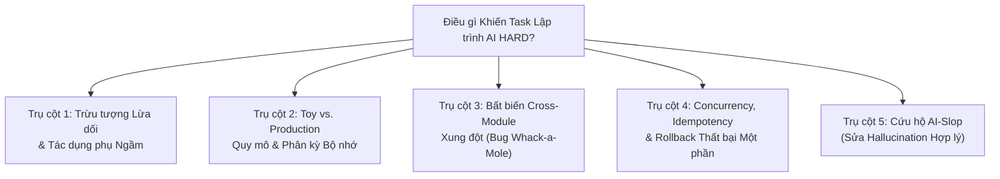

# Nghiên cứu Chuyên sâu: Điều gì Khiến Phỏng vấn Lập trình hỗ trợ AI Thật sự "HARD"?

## 1. Vì sao "LeetCode Hard" Truyền thống Đã Lỗi thời trong Phỏng vấn AI

Trong phỏng vấn lập trình không AI, một bài là **Hard** nếu đòi hỏi nhớ thuật toán ít gặp (ví dụ Tarjan SCC, luồng cực đại Dinic hoặc DP 3D) và gõ 80 dòng code không bug từ trí nhớ trong 40 phút.

Trong **Phỏng vấn Lập trình hỗ trợ AI**, ứng viên có thể paste prompt LeetCode Hard cổ điển vào GPT, Claude hoặc Gemini và nhận implementation $O(N \log N)$ hoạt động trong **4 giây**.

Vì vậy, **độ ít gặp của thuật toán không còn tạo ra độ khó.**  
Nghiên cứu qua các benchmark ngành (**vòng SWE hỗ trợ AI Meta**, **vòng Bug Bash / Tích hợp Stripe**, **Thử thách hỗ trợ AI Canva**, và các benchmark học thuật như **SWE-bench Verified** và **Multi-SWE-bench**) cho thấy điều thực sự phân biệt kỹ sư Senior/Staff với "Vibe-Coder" khi cả hai có cùng LLM:

> **Trong thế giới hỗ trợ AI, một task là HARD khi ngữ cảnh trải rộng nhiều file với bất biến ngầm, ràng buộc quy mô/concurrency và "Bẫy AI Cộng dồn" nơi prompt ngây thơ sinh code trông 100% hợp lý—thậm chí pass toy test—nhưng fail thảm khốc ở trường hợp biên, quy mô production hoặc tích hợp cross-module.**

---

## 2. 5 Trụ cột Phân loại của Task "Hard" hỗ trợ AI

Mỗi bài trong **[Cấp Hard (`cases/hard/`)](vi/Hard-Tier-Catalog)** được xây trên các GitHub repo mã nguồn mở thực tế và kết hợp ít nhất **ba** trong năm trụ cột sau:

### Trụ cột 1: Trừu tượng Lừa dối & Tác dụng phụ Ngầm

- **Cơ chế**: Một helper hoặc phương thức lớp trong File A có tên sạch (ví dụ `normalize_headers()`, `validate_schema()` hoặc `get_cached_session()`), nên LLM giả định nó là hàm pure. Thực tế nó đột biến dictionary dùng chung tại chỗ, loại bỏ tính phân biệt hoa thường cần downstream hoặc kích hoạt I/O lười.
- **Vì sao AI Fail**: Trừ khi kỹ sư theo dõi File A trước khi prompt File B, AI gọi helper trong vòng lặp và âm thầm làm hỏng trạng thái.
- **Năng lực Stress-Tested**: _Tiêu chí #4 (Tốc độ Đọc Code)_, _Tiêu chí #2 (Ngữ cảnh Prompt)_, _Tiêu chí #3 (Không Tin mù quáng AI)_.

### Trụ cột 2: Toy-vs-Production Quy mô & Phân kỳ Bộ nhớ

- **Cơ chế**: Workspace cung cấp cả fixture nhỏ (ví dụ 30 mục trong `get_test_dictionary()`) và fixture/benchmark production thực tế (ví dụ 50.000 từ, stream 100MB hoặc 10.000 node JSON lồng nhau).
- **Vì sao AI Fail**: Mặc định LLM tối ưu cho sự súc tích và dễ đọc, sinh $O(N^2)$ nối chuỗi, copy toàn danh sách mỗi vòng lặp hoặc đệ quy không bị chặn. Code pass toy test trong `5ms` và timeout hoặc gặp `RecursionError` / OOM trên production test.
- **Năng lực Stress-Tested**: _Tiêu chí #1 (Phân rã Vấn đề)_, _Tiêu chí #6 (Kiểm thử trước khi Tuyên bố Xong)_, _Tiêu chí #7 (Giải thích Tính đúng đắn & Độ phức tạp)_.

### Trụ cột 3: Bất biến Cross-Module Xung đột ("Whack-a-Mole" Rủi ro Regression)

- **Cơ chế**: Module X dựa vào hợp đồng thứ tự, tie-breaking hoặc truyền lỗi ngầm từ Module Y. Sửa bug trong Module Y theo cách "rõ ràng nhất" (AI luôn gợi ý đầu tiên) phá parser/serializer downstream của Module Z.
- **Vì sao AI Fail**: Khi ứng viên prompt _"Sửa test A đang fail"_, AI thay đổi Module Y và phá test B. Khi paste failure của test B, AI hoàn nguyên Module Y và phá test A lại—bẫy blind copy-paster trong vòng lặp vô hạn.
- **Năng lực Stress-Tested**: _Tiêu chí #1 (Divide & Conquer)_, _Tiêu chí #4 (Điều hướng Codebase)_, _Tiêu chí #5 (Khám phá Bug & Trường hợp Biên)_.

### Trụ cột 4: Concurrency, Idempotency & Làm hỏng Trạng thái Thất bại Một phần

- **Cơ chế**: Task liên quan async retry loop, connection pool, rate limiter phân tán, event stream hoặc state machine transactional nơi hai request đồng thời hoặc exception giữa chừng để hệ thống ở trạng thái nửa đột biến.
- **Vì sao AI Fail**: LLM thường viết code `async/await` hoặc mutex happy-path giữ lock qua network I/O, quên idempotency key khi retry, leak file descriptor khi cancellation hoặc fail rollback trạng thái một phần khi lỗi.
- **Năng lực Stress-Tested**: _Tiêu chí #3 (Hoài nghi AI)_, _Tiêu chí #5 (Khám phá Trường hợp Biên)_, _Tiêu chí #7 (Bảo vệ Giải pháp)_.

### Trụ cột 5: Cứu hộ "AI-Slop" Legacy (Kiểm toán & Viết lại Hallucination Hợp lý)

- **Cơ chế**: Nhánh khởi đầu chứa tính năng/PR trước đó do developer tin mù quáng LLM viết. Code dài dòng, comment tốt và pass 80% happy-path test, nhưng chứa 3–4 lỗi logic đan xen, test over-mock không assert gì hoặc bypass validation/security tinh vi.
- **Vì sao AI Fail**: Khi hỏi LLM _"Có gì sai với code này?"_, nó thường bị đánh lừa bởi style hợp lý và comment xu nịnh của chính nó! Kỹ sư con người phải theo dõi logic từ nguyên tắc đầu tiên, xóa các trừu tượng AI chết/hỏng và rebuild sạch.
- **Năng lực Stress-Tested**: _Tất cả 7 Tiêu chí—đặc biệt #3 (Không Tin mù quáng AI) và #5 (Khám phá Bug & Trường hợp Biên)_.

---

## 3. Bảng So sánh: Hiệu chỉnh Easy vs Medium vs Hard

| Chiều                     | Cấp Easy (`cases/easy/`)                                                   | Cấp Medium (`cases/medium/`)                                                           | Cấp Hard (`cases/hard/`)                                                                                                              |
| :------------------------ | :------------------------------------------------------------------------- | :------------------------------------------------------------------------------------- | :------------------------------------------------------------------------------------------------------------------------------------ |
| **Thời lượng Mục tiêu**   | 30–45 phút                                                                 | 45–60 phút (Chuẩn Meta)                                                                | 60–75 phút (Senior / Staff)                                                                                                           |
| **File Liên quan**        | 2–4 file (1 module lõi + 1 test file)                                      | 3–6 file qua 2–3 module                                                                | 3–6 file trong repo OSS production thực tế                                                                                            |
| **Bug Gieo sẵn / Có sẵn** | 1–2 bug logic cục bộ                                                       | 1–3 bug tương tác qua module                                                           | 2–4 bug tinh vi liên quan trạng thái, quy mô, concurrency hoặc bất biến                                                               |
| **Độ phức tạp Bẫy AI**    | **Bẫy Đơn**: Phần tử trùng, off-by-one biên hoặc vòng lặp $O(N^2)$ cơ bản. | **Bẫy Kép**: Prompt ngây thơ phá hợp đồng interface hoặc fail trên production dataset. | **Bẫy Cộng dồn**: Sửa Bug A ngây thơ phá Module B; đòi hỏi phân rã kiến trúc trước khi prompt.                                        |
| **GitHub Repo Nguồn**     | Polyglot Refactoring Katas (`@emilybache`, Coding Dojo)                    | Contained Apps, Solvers, Micro-Libraries (`RealWorld`, `ky`, `hono`, v.v.)             | Production OSS Libraries & `Multi-SWE-bench` commits (`httpx`, `zod`, `cobra`, `gson`, `serde_json`, `pydantic`, `rich`, `bubbletea`) |

---

## 4. Tóm tắt 10 Bài Hard trong Kho này

Để cung cấp benchmark polyglot hoàn chỉnh cho HR và kỹ sư Senior/Staff, **[10 Bài Hard](vi/Hard-Tier-Catalog)** của chúng ta trải rộng 5 ngôn ngữ lập trình và cả 5 Trụ cột Phân loại Hard:

| Case ID                                         | Trang Bài Độc lập                                                                                    | GitHub Repo Nguồn                                                                                                                                                                                                     | Ngôn ngữ                                   | Bẫy AI Chính được Test                                         |
| :---------------------------------------------- | :--------------------------------------------------------------------------------------------------- | :-------------------------------------------------------------------------------------------------------------------------------------------------------------------------------------------------------------------- | :----------------------------------------- | :------------------------------------------------------------- |
| **[H01](vi/H01-httpx-redirect-pool)**           | [Async HTTP Connection Pool & Rò rỉ Auth Redirect Cross-Origin](vi/H01-httpx-redirect-pool)          | [`encode/httpx`](https://github.com/encode/httpx)                                                                                                                                                                     | `Python`                                   | Concurrency/Locking + Bất biến Bảo mật Cross-Module            |
| **[H02](vi/H02-zod-cyclic-schema)**             | [Recursive Schema Validation & Cyclic Type Inference](vi/H02-zod-cyclic-schema)                      | [`colinhacks/zod`](https://github.com/colinhacks/zod)                                                                                                                                                                 | `TypeScript`                               | Quy mô Toy-vs-Prod + Trạng thái Parse Context Đột biến         |
| **[H03](vi/H03-bubbletea-event-loop)**          | [Concurrent TUI Event Loop & Command Batching Race](vi/H03-bubbletea-event-loop)                     | [`charmbracelet/bubbletea`](https://github.com/charmbracelet/bubbletea)                                                                                                                                               | `Go`                                       | Goroutine Channel Deadlock + Bất biến Thứ tự Giao hàng         |
| **[H04](vi/H04-gson-polymorphic-adapter)**      | [Polymorphic JSON TypeAdapter & Mất Độ chính xác Số](vi/H04-gson-polymorphic-adapter)                | [`google/gson`](https://github.com/google/gson)                                                                                                                                                                       | `Java`                                     | Reflection Cache Poisoning + Hợp đồng Kiểu Xung đột            |
| **[H05](vi/H05-serde-streaming-json)**          | [Zero-Copy Streaming Deserializer & Buffering Boundary](vi/H05-serde-streaming-json)                 | [`serde-rs/json`](https://github.com/serde-rs/json)                                                                                                                                                                   | `Rust`                                     | Bẫy Lifetime Borrow-Checker + Biên Buffer Streaming            |
| **[H06](vi/H06-pydantic-validator-mro)**        | [Model Validator Inheritance MRO & Mất Độ chính xác Số](vi/H06-pydantic-validator-mro)               | [`pydantic/pydantic`](https://github.com/pydantic/pydantic)                                                                                                                                                           | `Python`                                   | Trừu tượng Metaclass Lừa dối + Default Dùng chung Đột biến     |
| **[H07](vi/H07-tanstack-optimistic-query)**     | [Async Query Cache Deduplication & Optimistic Rollback](vi/H07-tanstack-optimistic-query)            | [`TanStack/query`](https://github.com/TanStack/query)                                                                                                                                                                 | `TypeScript`                               | Hủy Promise Out-of-Order + Bẫy Stale Closure                   |
| **[H08](vi/H08-cobra-flag-propagation)**        | [Hierarchical CLI Flag Propagation & PersistentPreRun Hook Shadowing](vi/H08-cobra-flag-propagation) | [`spf13/cobra`](https://github.com/spf13/cobra)                                                                                                                                                                       | `Go`                                       | Duyệt Cây Cha-Con + Hợp đồng Tương thích Ngược                 |
| **[H09](vi/H09-rich-wide-char-table)**          | [ANSI Wide-Character Table Layout Engine & Wrapping Perf Cliff](vi/H09-rich-wide-char-table)         | [`Textualize/rich`](https://github.com/Textualize/rich)                                                                                                                                                               | `Python`                                   | Bẫy Độ rộng Ô Unicode + Nút thắt Đo lường $O(N^2)$             |
| **[H10](vi/H10-legacy-billing-ai-slop-rescue)** | [Legacy Rule Engine & Tax Calculation "AI-Slop" Rescue](vi/H10-legacy-billing-ai-slop-rescue)        | [`stripe-samples/subscription-use-cases`](https://github.com/stripe-samples/subscription-use-cases) · [`getlago/lago`](https://github.com/getlago/lago) · [`killbill/killbill`](https://github.com/killbill/killbill) | `Python`, `TS`, `Go`, `Java`, `Rust`, `C#` | Cứu hộ PR Hallucination AI-Slop + Bất biến Làm tròn Đa tiền tệ |

---

## 5. Nguồn & Đọc thêm

- SWE-bench Verified (Princeton NLP) — benchmark cho agent kỹ thuật phần mềm.
- Multi-SWE-bench — phiên bản đa ngôn ngữ của SWE-bench.
- Các bài viết kỹ thuật công khai về vòng phỏng vấn hỗ trợ AI (Meta, Canva, Stripe) — tham khảo như nguồn cảm hứng; kho này không liên kết với bất kỳ hãng nào trong số đó.
