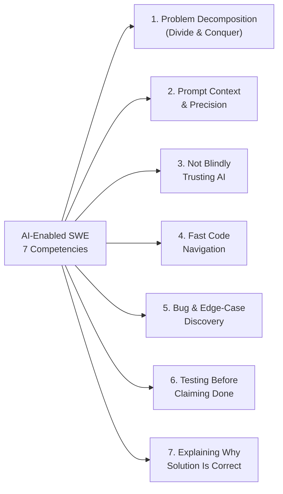
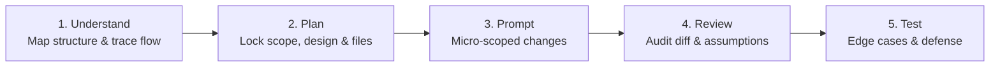

# 🧠 Welcome to the AI-Enabled Coding Interviews Wiki

> **The Complete Open-Source Knowledge Base, 7-Criteria HR Rubric, Divide-and-Conquer Prompt Playbook, and 30 GitHub-Backed Cases for AI-Enabled SWE Interviews.**

---

## 🚀 Start Here by Role

| Role | Recommended Wiki Path |
| :--- | :--- |
| **👔 HR, Talent Acquisition & Technical Interviewers** | 1. **[The 7 Evaluation Criteria](01-THE-7-EVALUATION-CRITERIA)** — Understand the 1–4 behavioral rubric and Instant Red Flags. 2. **[HR & Interviewer Runbook](03-HR-AND-INTERVIEWER-RUNBOOK)** — 60-minute timeline, clean-room git setup, and level calibration. 3. **[Candidate Scorecard Template](SCORECARD_TEMPLATE)** — Copy-paste evaluation sheet for interview debriefs. |
| **💻 Software Engineers & Interview Candidates** | 1. **[Employee Mindset & Prompt Playbook](02-EMPLOYEE-MINDSET-AND-PROMPT-PLAYBOOK)** — Master **Divide and Conquer** (`Understand → Plan → Prompt → Review → Test`) + copy-pasteable starter prompts. 2. **[Hard Level Research & AI Traps](04-HARD-LEVEL-RESEARCH-AND-AI-TRAPS)** — Learn the 5 Taxonomy Pillars where LLMs fail. 3. Pick a case from **[Easy](Easy-Tier-Catalog)**, **[Medium](Medium-Tier-Catalog)**, or **[Hard](Hard-Tier-Catalog)** and practice under a 60-minute timer. |

---

## 🎯 The 7 Core Competencies at a Glance

---

## 🔄 The 5-Step Candidate Loop (`Divide & Conquer`)

---

## 📚 Complete 30-Case Wiki Directory

### 🔴 [Hard Tier (`60–75 mins` — Senior / Staff Bar)](Hard-Tier-Catalog)
1. **[H01 — Async HTTP Connection Pool & Redirect Auth Leak](H01-httpx-redirect-pool)** (`encode/httpx` · `Python`)
2. **[H02 — Recursive Schema Validation & Cyclic Object Graph Tracker](H02-zod-cyclic-schema)** (`colinhacks/zod` · `TypeScript`)
3. **[H03 — Concurrent TUI Event Loop & Command Batching Deadlock](H03-bubbletea-event-loop)** (`charmbracelet/bubbletea` · `Go`)
4. **[H04 — Polymorphic JSON TypeAdapter & Number Precision Trap](H04-gson-polymorphic-adapter)** (`google/gson` · `Java`)
5. **[H05 — Zero-Copy Streaming JSON Deserializer & Buffer Boundary](H05-serde-streaming-json)** (`serde-rs/json` · `Rust`)
6. **[H06 — Model Validator Inheritance MRO & Default Factory Leak](H06-pydantic-validator-mro)** (`pydantic/pydantic` · `Python`)
7. **[H07 — Async Query Cache Deduplication & Optimistic Rollback Race](H07-tanstack-optimistic-query)** (`TanStack/query` · `TypeScript`)
8. **[H08 — Hierarchical CLI Flag Propagation & Hook Shadowing](H08-cobra-flag-propagation)** (`spf13/cobra` · `Go`)
9. **[H09 — ANSI Wide-Character Table Layout & Wrapping Perf Cliff](H09-rich-wide-char-table)** (`Textualize/rich` · `Python`)
10. **[H10 — Multi-Language Legacy Billing Engine ("AI-Slop" Rescue)](H10-legacy-billing-ai-slop-rescue)** (`Polyglot: Python, TS, Go, Java, Rust, C#`)

### 🟡 [Medium Tier (`45–60 mins` — Meta / Canva / Stripe Bar)](Medium-Tier-Catalog)
1. **[M01 — Secret Word Puzzle & Entropy Solver Engine *(Meta Flagship)*](M01-wordle-puzzle-solver)** (`Python, TS, Go, Java`)
2. **[M02 — Legacy Service Refactoring & Dependency Inversion](M02-legacy-service-refactoring)** (`Java, TS, Python`)
3. **[M03 — Concurrent Worker Pool & Graceful Context Cancellation](M03-concurrent-worker-pool)** (`Go, TS, Python, Rust`)
4. **[M04 — HTTP Retry Middleware & Exponential Backoff Jitter](M04-http-retry-middleware)** (`TS, Python, Go`)
5. **[M05 — Radix Trie URL Router & Wildcard Param Precedence](M05-radix-trie-router)** (`TS, Go, Python, Rust`)
6. **[M06 — Conduit Article Feed Pagination & N+1 Tag Hydration](M06-conduit-feed-pagination)** (`Python, TS, Go, Java`)
7. **[M07 — Markdown Table & Footnote AST Tokenizer](M07-markdown-table-tokenizer)** (`Python, TS, Rust`)
8. **[M08 — In-Memory TTL Cache with LRU Eviction & Stampede Lock](M08-ttl-lru-cache-stampede)** (`Go, TS, Python, Java`)
9. **[M09 — CLI Subcommand Option Parser & Env-Var Precedence](M09-cli-option-precedence)** (`Python, TS, Go, Rust`)
10. **[M10 — Event-Sourced Ledger & Out-of-Order Webhook Reconciliation](M10-event-sourced-ledger)** (`TS, Python, Java, Go`)

### 🟢 [Easy Tier (`30–45 mins` — Polyglot Katas)](Easy-Tier-Catalog)
1. **[E01 — Gilded Rose Inventory Bugfix & Conjured Decay Cap](E01-gilded-rose)** (`Python, TS, Go, Java, Rust, C#`)
2. **[E02 — Supermarket Receipt Discount Stacking & Bundle Rounding](E02-supermarket-receipt)** (`Python, TS, Go, Java, Rust, C#`)
3. **[E03 — Theatrical Players Statement Formatter & HTML Loyalty Credits](E03-theatrical-players)** (`Python, TS, Go, Java, Rust, C#`)
4. **[E04 — Tennis Match Tie-Break & Advantage State Machine](E04-tennis-score)** (`Python, TS, Go, Java, Rust, C#`)
5. **[E05 — Lift Pass Dynamic Pricing & Holiday Blackout Calendar](E05-lift-pass-pricing)** (`Python, TS, Go, Java, C#`)
6. **[E06 — Build Pipeline Notification Router & Flaky Step Retry](E06-build-pipeline)** (`Python, TS, Go, Java, Rust, C#`)
7. **[E07 — Yatzy Category Scorer & Wild Joker Die Rule](E07-yatzy-scorer)** (`Python, TS, Go, Java, Rust, C#`)
8. **[E08 — Delivery Controller Slot Capacity & Time-Zone Cutoff](E08-delivery-controller)** (`Python, TS, Java, C#`)
9. **[E09 — Expense Report Meal Cap Auditor & Multi-Currency Conversion](E09-expense-report)** (`Python, TS, Go, Java, Rust, C#`)
10. **[E10 — Racing Car Telemetry Alarm & Sliding Window Drift Detector](E10-racing-car-telemetry)** (`Python, TS, Go, Java, C#`)
