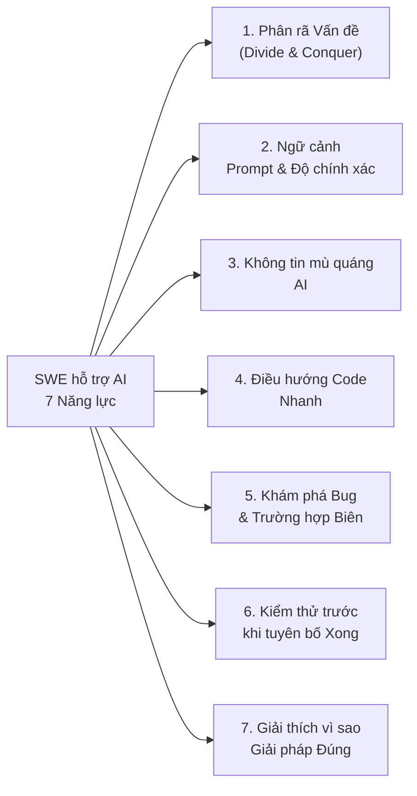
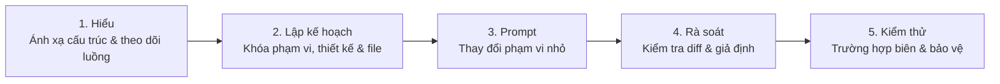

# 🧠 Chào mừng đến với Wiki Phỏng vấn Lập trình hỗ trợ AI

> 🌐 Ngôn ngữ: <a href="Home">English</a> · **Tiếng Việt**

> **Cơ sở kiến thức mã nguồn mở hoàn chỉnh, bộ tiêu chí đánh giá HR 7 tiêu chí, Sổ tay Prompt Divide-and-Conquer, và 30 bài toán GitHub thực tế cho phỏng vấn SWE hỗ trợ AI.**

---

## 🚀 Bắt đầu theo vai trò

| Vai trò                                                  | Lộ trình Wiki đề xuất                                                                                                                                                                                                                                                                                                                                                                                                                                                                                       |
| :------------------------------------------------------- | :---------------------------------------------------------------------------------------------------------------------------------------------------------------------------------------------------------------------------------------------------------------------------------------------------------------------------------------------------------------------------------------------------------------------------------------------------------------------------------------------------------- |
| **👔 HR, Talent Acquisition & Người phỏng vấn kỹ thuật** | 1. **[7 Tiêu chí Đánh giá](vi/01-THE-7-EVALUATION-CRITERIA)** — Hiểu thang điểm hành vi 1–4 và các Red Flag tức thì. 2. **[Sổ tay HR & Người phỏng vấn](vi/03-HR-AND-INTERVIEWER-RUNBOOK)** — Lịch 60 phút, thiết lập clean-room git, và hiệu chỉnh cấp độ. 3. **[Mẫu Scorecard Ứng viên](vi/SCORECARD_TEMPLATE)** — Bảng đánh giá copy-paste cho buổi debrief.                                                                                                                                       |
| **💻 Kỹ sư phần mềm & Ứng viên phỏng vấn**               | 1. **[Tư duy Nhân viên & Sổ tay Prompt](vi/02-EMPLOYEE-MINDSET-AND-PROMPT-PLAYBOOK)** — Thành thạo **Divide and Conquer** (`Understand → Plan → Prompt → Review → Test`) + prompt khởi động copy-paste. 2. **[Nghiên cứu Cấp Hard & Bẫy AI](vi/04-HARD-LEVEL-RESEARCH-AND-AI-TRAPS)** — Học 5 Trụ cột Phân loại nơi LLM thất bại. 3. Chọn một bài từ **[Easy](vi/Easy-Tier-Catalog)**, **[Medium](vi/Medium-Tier-Catalog)**, hoặc **[Hard](vi/Hard-Tier-Catalog)** và luyện tập dưới đồng hồ 60 phút. |

---

## 🎯 7 Năng lực Cốt lõi Tóm tắt

---

## 🔄 Vòng lặp Ứng viên 5 Bước (`Divide & Conquer`)

---

## 📚 Thư mục Wiki 30 Bài toán

### 🔴 [Cấp Hard (`60–75 phút` — Mức Senior / Staff)](vi/Hard-Tier-Catalog)

1. **[H01 — Async HTTP Connection Pool & Rò rỉ Auth Redirect](vi/H01-httpx-redirect-pool)** (`encode/httpx` · `Python`)
2. **[H02 — Recursive Schema Validation & Cyclic Object Graph Tracker](vi/H02-zod-cyclic-schema)** (`colinhacks/zod` · `TypeScript`)
3. **[H03 — Concurrent TUI Event Loop & Command Batching Deadlock](vi/H03-bubbletea-event-loop)** (`charmbracelet/bubbletea` · `Go`)
4. **[H04 — Polymorphic JSON TypeAdapter & Number Precision Trap](vi/H04-gson-polymorphic-adapter)** (`google/gson` · `Java`)
5. **[H05 — Zero-Copy Streaming JSON Deserializer & Buffer Boundary](vi/H05-serde-streaming-json)** (`serde-rs/json` · `Rust`)
6. **[H06 — Model Validator Inheritance MRO & Default Factory Leak](vi/H06-pydantic-validator-mro)** (`pydantic/pydantic` · `Python`)
7. **[H07 — Async Query Cache Deduplication & Optimistic Rollback Race](vi/H07-tanstack-optimistic-query)** (`TanStack/query` · `TypeScript`)
8. **[H08 — Hierarchical CLI Flag Propagation & Hook Shadowing](vi/H08-cobra-flag-propagation)** (`spf13/cobra` · `Go`)
9. **[H09 — ANSI Wide-Character Table Layout & Wrapping Perf Cliff](vi/H09-rich-wide-char-table)** (`Textualize/rich` · `Python`)
10. **[H10 — Multi-Language Legacy Billing Engine ("AI-Slop" Rescue)](vi/H10-legacy-billing-ai-slop-rescue)** (`stripe-samples` · `getlago/lago` · `killbill/killbill`)

### 🟡 [Cấp Medium (`45–60 phút` — Mức Meta / Canva / Stripe)](vi/Medium-Tier-Catalog)

1. **[M01 — Secret Word Puzzle & Entropy Solver Engine _(Meta Flagship)_](vi/M01-wordle-puzzle-solver)** (`Python, TS, Go, Java, Rust`)
2. **[M02 — Legacy Monolith Dijkstra & Algorithm Dependency Inversion](vi/M02-legacy-service-refactoring)** (`Java, Kotlin`)
3. **[M03 — Concurrent Worker Pool & Graceful Context Cancellation](vi/M03-concurrent-worker-pool)** (`Go, TS, Python, Rust`)
4. **[M04 — HTTP Retry Middleware & Exponential Backoff Jitter](vi/M04-http-retry-middleware)** (`TS, Python, Go`)
5. **[M05 — Radix Trie URL Router & Wildcard Param Precedence](vi/M05-radix-trie-router)** (`TS, Go, Python, Rust`)
6. **[M06 — Conduit Article Feed Pagination & N+1 Tag Hydration](vi/M06-conduit-feed-pagination)** (`Python, TS, Go, Java`)
7. **[M07 — Markdown Table & Footnote AST Tokenizer](vi/M07-markdown-table-tokenizer)** (`Python, TS, Rust`)
8. **[M08 — In-Memory TTL Cache with LRU Eviction & Stampede Lock](vi/M08-ttl-lru-cache-stampede)** (`Go, TS, Python, Java`)
9. **[M09 — CLI Subcommand Option Parser & Env-Var Precedence](vi/M09-cli-option-precedence)** (`Python, TS, Go, Rust`)
10. **[M10 — Event-Sourced Ledger & Out-of-Order Webhook Reconciliation](vi/M10-event-sourced-ledger)** (`TS, Go, Python, Java`)

### 🟢 [Cấp Easy (`30–45 phút` — Polyglot Katas)](vi/Easy-Tier-Catalog)

1. **[E01 — Gilded Rose Inventory Bugfix & Conjured Decay Cap](vi/E01-gilded-rose)** (`Python, TS, Go, Java, Rust, C#`)
2. **[E02 — Supermarket Receipt Discount Stacking & Bundle Rounding](vi/E02-supermarket-receipt)** (`Python, TS, Go, Java, C#`)
3. **[E03 — Theatrical Players Statement Formatter & HTML Loyalty Credits](vi/E03-theatrical-players)** (`Python, TS, Go, Java, Rust, C#`)
4. **[E04 — Tennis Match Tie-Break & Advantage State Machine](vi/E04-tennis-score)** (`Python, TS, Go, Java, Rust, C#`)
5. **[E05 — Lift Pass Dynamic Pricing & Holiday Blackout Calendar](vi/E05-lift-pass-pricing)** (`Python, TS, Java, C#`)
6. **[E06 — Build Pipeline Notification Router & Flaky Step Retry](vi/E06-build-pipeline)** (`Python, Go, Java, C#`)
7. **[E07 — Yatzy Category Scorer & Wild Joker Die Rule](vi/E07-yatzy-scorer)** (`Python, TS, Go, Java, Rust, C#`)
8. **[E08 — Delivery Route ETA Tracker & Idempotent Event Replay](vi/E08-delivery-controller)** (`Python, TS, Java, C#`)
9. **[E09 — Expense Report Meal Cap Auditor & Multi-Currency Conversion](vi/E09-expense-report)** (`Python, TS, Go, Java, Rust, C#`)
10. **[E10 — Racing Car Telemetry Alarm & Sliding Window Drift Detector](vi/E10-racing-car-telemetry)** (`Python, TS, Go, Java, Rust, C#`)
